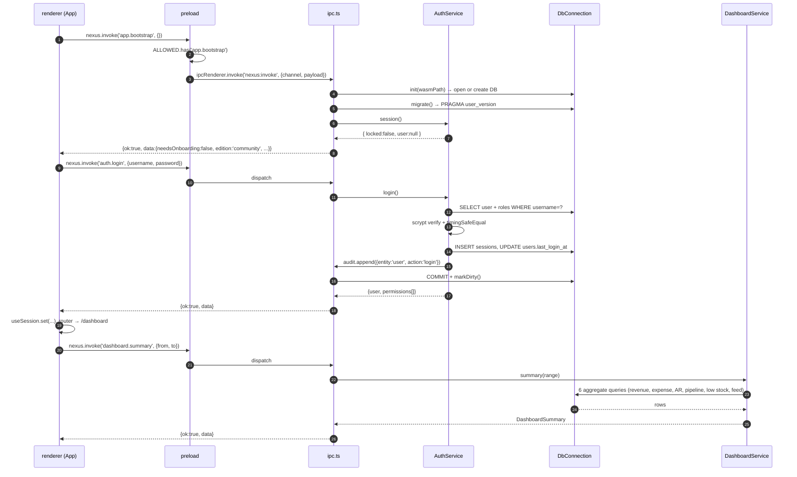
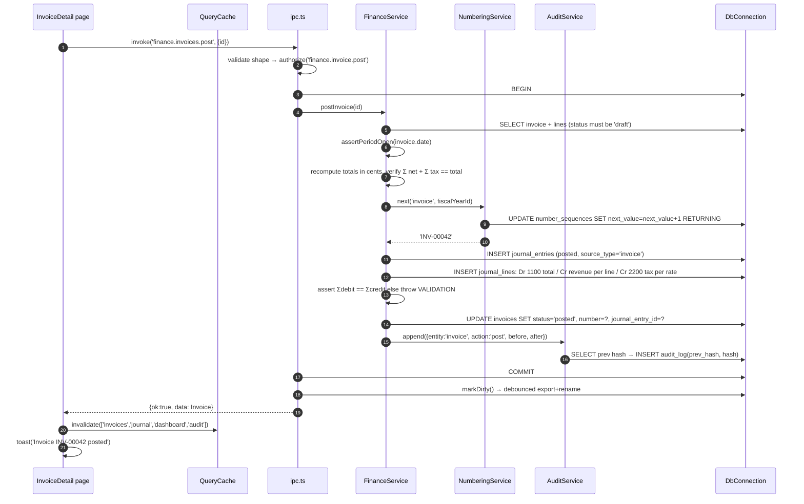
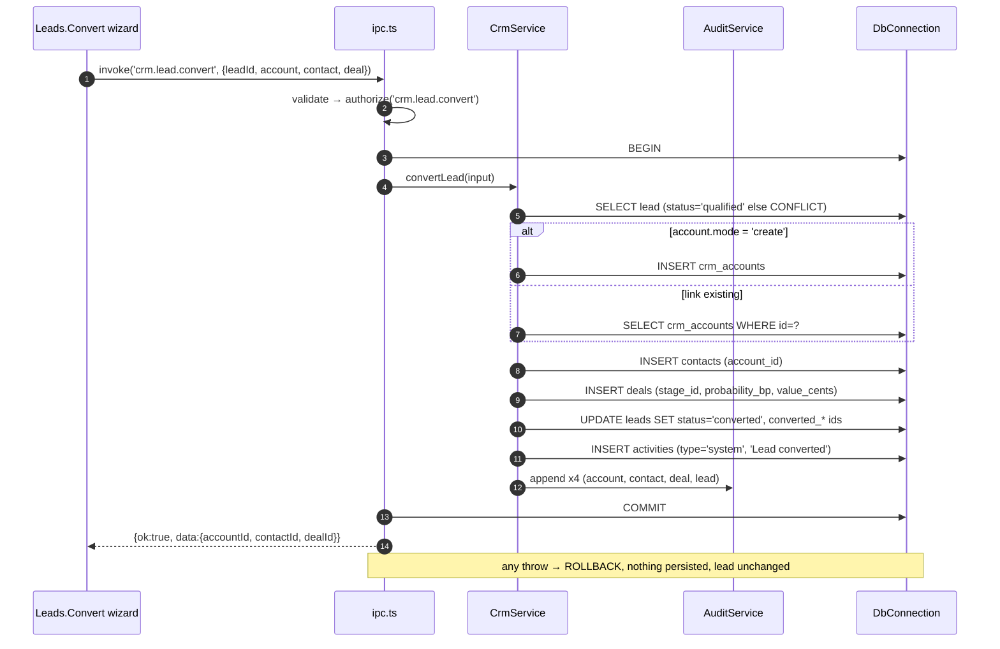
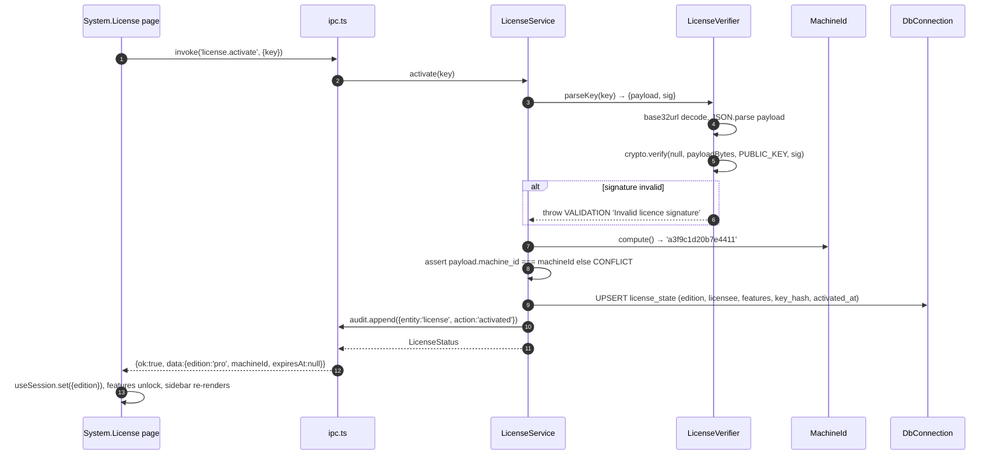
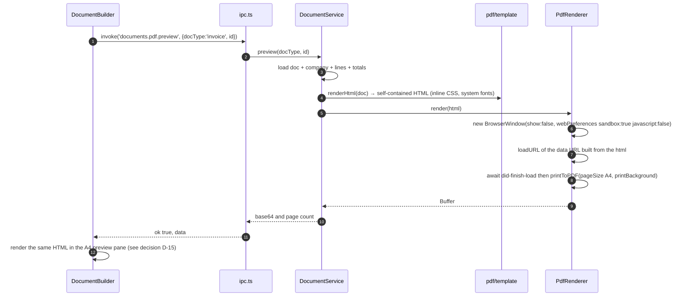

<!-- Copyright (c) 2026 arfanayub0. All rights reserved. Licensed under the NEXUS Proprietary Perpetual License. See LICENSE. -->

# NEXUS — System Architecture

| Field | Value |
|---|---|
| **Version** | 1.0 |
| **Author** | 高见远 (Architect) |
| **Inputs** | `PRD.md` (58 P0 stories, 72 screens, BR-01..25), `RESEARCH.md`, pinned tech decisions from the build lead |
| **Runtime** | Electron 33.4.11 · Chromium + Node 22 · Windows-first, cross-platform |
| **Renderer** | React 18 · TypeScript 5 strict · Vite 5 · React Router 6 (hash) · Zustand · Tailwind 3 · lucide-react · recharts |
| **Persistence** | `sql.js` (SQLite/WASM) — **zero native modules** |
| **Sibling docs** | `TASKS.md` (execution order), `CONVENTIONS.md` (the contract every file must obey) |

**One-paragraph summary.** NEXUS is a hardened Electron app with three trust zones: the **renderer** is a pure, sandboxed UI that can only reach the system through one preload-exposed function; the **preload** is a fixed allow-list of channel names and nothing else; the **main process** owns the database, auth, RBAC, licence, audit chain, PDF and XLSX. The database is a `sql.js` in-memory SQLite image persisted atomically to `%APPDATA%/nexus/nexus.db` after every mutating call. Every mutation is validated, authorised, executed in a transaction, appended to a hash-chained audit log, and only then returned as a DTO. Screens are generated from a metadata entity registry plus a module manifest, so "cross-industry" is a preset object, never a branch.

---

## A. Process model & folder map

### A.1 Trust zones

```
┌─────────────────────────── renderer (sandbox: true, contextIsolation: true) ───────────────────────────┐
│ React 18 · hash router · Zustand · Tailwind      NO node, NO fs, NO sql, NO remote fetch (CSP)          │
│                                   window.nexus.invoke(channel, payload)                                 │
└───────────────────────────────────────────────────┬────────────────────────────────────────────────────┘
                                                    │  ipcRenderer.invoke('nexus:invoke', {channel,payload})
┌───────────────────────────────────────────────────▼────────────────────────────────────────────────────┐
│ preload (sandboxed, no node integration)                                                                │
│   const ALLOWED = new Set([...])   // literal channel names, compiled in                                │
│   invoke(channel,payload) { if(!ALLOWED.has(channel)) reject; return ipcRenderer.invoke(...) }           │
└───────────────────────────────────────────────────┬────────────────────────────────────────────────────┘
┌───────────────────────────────────────────────────▼────────────────────────────────────────────────────┐
│ main process — the only privileged code                                                                 │
│  ipc.ts: shape-validate → RBAC authorize → tx { handler → audit.append } → persist → DTO                │
│  db/ (sql.js)  services/  pdf/  license/  jobs.ts                                                       │
└────────────────────────────────────────────────────────────────────────────────────────────────────────┘
```

### A.2 Folder tree — **105 source files**, one line of purpose each

```
nexus/
├─ package.json                       scripts: dev|build|dist|typecheck|test; exact pinned deps
├─ tsconfig.json                      renderer + shared; strict, noEmit, moduleResolution "bundler"
├─ tsconfig.main.json                 main + preload + shared → dist/main; CommonJS, ES2022
├─ vite.config.ts                     renderer build → dist/renderer, base:'./', manualChunks for vendor
├─ tailwind.config.js                 maps tokens → utilities; no raw colours; density via CSS vars
├─ postcss.config.js                  tailwindcss + autoprefixer
├─ electron-builder.yml               NSIS + portable; extraResources sql-wasm.wasm; asar on
├─ .gitignore                         node_modules dist release *.db keys/ src/main/license/pubkey.ts
├─ LICENSE                            NEXUS Proprietary Perpetual License (verbatim, no copyleft)
├─ EULA.md                            end-user terms: perpetual, offline, no telemetry, 1 machine
├─ README.md                          dev setup, wasm packaging note, keygen usage, build commands
├─ scripts/gen-license-keys.mjs       dev-only: Ed25519 keypair → keys/private.pem + pubkey.ts
├─ scripts/keygen.mjs                 issue customer key from private.pem: --edition --licensee --machine-id
│
├─ src/shared/                       ── imported by BOTH main and renderer (pure, no node APIs) ──
│  ├─ types.ts                        all DTOs, entity registry ENTITIES, DocumentStatus, ListQuery/ListResult
│  ├─ channels.ts                     CHANNELS const map (single source of truth for the allow-list)
│  ├─ schemas.ts                      hand-rolled validators: v.str/int/cents/iso/enum/array/obj per payload
│  ├─ money.ts                        Cents brand, add/sub/mulQty/pct/roundHalfUp/roundHalfEven/format/parse
│  ├─ dates.ts                        ISO-8601 UTC helpers: nowIso, addDays, addMonths, periodOf, fmt
│  ├─ permissions.ts                  PERMISSIONS catalog, ROLE_PRESETS, union-of-roles evaluation
│  ├─ modules.ts                      ModuleManifest type + MODULES registry (8 modules)
│  └─ industry-presets.ts             7 IndustryPreset objects (modules, CoA codes, taxes, prefixes, fields)
│
├─ src/main/
│  ├─ index.ts                        app lifecycle, single-instance lock, bootstrap, before-quit flush
│  ├─ window.ts                       createMainWindow(), createPrintWindow() (offscreen, sandboxed)
│  ├─ security.ts                     CSP header injection, navigation guards, permission handler, devtools
│  ├─ ipc.ts                          channel registry, envelope, validate→authorize→tx→audit→persist
│  ├─ jobs.ts                         idle timer tick, license heartbeat, debounce flush, notification sweep
│  ├─ db/
│  │  ├─ connection.ts                sql.js init (locateFile dev+packaged), query helpers, tx(), dirty flag
│  │  ├─ schema.ts                    DDL: all CREATE TABLE/INDEX strings + PRAGMA user_version
│  │  ├─ migrate.ts                   ordered migrations keyed on PRAGMA user_version
│  │  └─ seed.ts                      CoA template per preset, demo dataset, number sequences, pipelines
│  ├─ services/
│  │  ├─ auth.ts                      scrypt hash/verify, login, lock/unlock, sessions, idle policy
│  │  ├─ users.ts                     user & role CRUD, permission resolution, disable-not-delete
│  │  ├─ audit.ts                     append(entry) with prev_hash chain, verifyChain(), filtered query
│  │  ├─ license.ts                   activate/deactivate/status, clock-rollback detection, edition gating
│  │  ├─ settings.ts                  company, taxes, currencies, numbering, custom fields, saved views, presets
│  │  ├─ finance.ts                   COA, journals, invoices, bills, payments, reports, periods, posting engine
│  │  ├─ inventory.ts                 products, warehouses, locations, stock moves, on-hand, valuation
│  │  ├─ purchasing.ts                vendors, POs, receipts, bills-from-receipt, 3-way match
│  │  ├─ sales.ts                     customers, quotes, orders, deliveries, price resolution
│  │  ├─ crm.ts                       accounts, contacts, leads, atomic conversion, deals, activities, analytics
│  │  ├─ dashboard.ts                 KPI bundle with prior-period comparison, needs-attention, feed
│  │  ├─ documents.ts                 pdf preview/save, print, XLSX/CSV export dispatch
│  │  ├─ importexport.ts              CSV/XLSX parse, column mapping, row validation, staged commit
│  │  ├─ backup.ts                    consistent copy, integrity check, restore with re-login
│  │  └─ search.ts                    global search + command-palette index (records/actions/nav)
│  ├─ pdf/
│  │  ├─ template.ts                  self-contained HTML for 5 doc types (inline CSS, system fonts)
│  │  └─ render.ts                    offscreen BrowserWindow → loadURL(data:) → printToPDF → base64
│  └─ license/
│     ├─ pubkey.ts                    GENERATED, gitignored-replaced build artefact: base64 SPKI public key
│     ├─ verify.ts                    base32url decode, payload parse, Ed25519 verify, machine binding
│     └─ machine.ts                   sha256(hostname+platform+arch+firstMac) → 16 hex chars
│
├─ src/preload/index.ts               window.nexus = {invoke, on, platform, version} + ALLOWED channel set
│
└─ src/renderer/
   ├─ index.html                      <meta CSP>, root div, no external references
   ├─ main.tsx                        React root, hash router, error boundary, bootstrap() before render
   ├─ App.tsx                         route table (72 routes), guards (onboarding/login/locked/permission)
   ├─ index.css                       @font-face (self-hosted OFL), :root + [data-theme] token values
   ├─ lib/
   │  ├─ api.ts                      typed invoke() wrapper: envelope unwrap, error → ApiError, channel types
   │  ├─ format.ts                   money/date/qty/percent formatters bound to session locale + currency
   │  ├─ useQuery.ts                 IPC cache: useQuery(key,fn), invalidate(tags), optimistic helpers
   │  └─ toast.ts                    toast store + <Toaster/> render contract (max 3, errors sticky)
   ├─ store/index.ts                 Zustand: session (user, permissions, edition), ui (theme, density, lock)
   ├─ components/
   │  ├─ AppShell.tsx                nav/main/aside landmarks, skip-link, route transition, lock overlay host
   │  ├─ Sidebar.tsx                 240/64px rail, module groups, permission-filtered, collapse persisted
   │  ├─ Topbar.tsx                  global search, ⌘K hint, period selector, density, theme, user menu
   │  ├─ CommandPalette.tsx          fuzzy over nav+records+actions, grouped, recent-first, max 8/group
   │  ├─ DataTable.tsx               hand-windowed virtual body, sticky header, sort, select, quick actions
   │  ├─ Kanban.tsx                  columns w/ stage totals, HTML5 DnD + keyboard move menu, optimistic
   │  ├─ Modal.tsx                   focus trap/restore, Esc, typed-confirmation variant
   │  ├─ Drawer.tsx                  420px peek panel, non-destructive, Esc restores focus to origin cell
   │  ├─ Field.tsx                   Field/FormGrid/MoneyInput/Select/DateInput with aria-describedby errors
   │  ├─ DocumentBuilder.tsx         58/42 split view: form left, debounced (250ms) PDF preview right
   │  ├─ Chart.tsx                   recharts wrappers themed by tokens (no hex in props)
   │  ├─ LockScreen.tsx              full-cover lock, re-auth restores route + unsaved form state
   │  ├─ PermissionGate.tsx          renders children only when permission held (absent, never disabled)
   │  └─ ui.tsx                      PageHeader, StatCard, EmptyState, StatusChip, Toolbar, Skeleton
   └─ pages/
      ├─ Onboarding.tsx              5-step wizard: company → preset → currency/FY → admin → licence+demo
      ├─ Auth.tsx                    /login (first-run hint, show password)
      ├─ Dashboard.tsx               KPI strip, revenue/expense chart, pipeline summary, needs-attention, feed
      ├─ Search.tsx                  /search results with type badges
      ├─ Print.tsx                   /print/:docType/:id preview host (iframe-free, main-rendered PDF)
      ├─ finance/Accounts.tsx        COA tree + /finance/accounts/:id GL preview
      ├─ finance/Journals.tsx        list + editor (balance helper) + detail (reverse/print)
      ├─ finance/Invoices.tsx        AR list + split-view builder + detail (post/pay/print/void)
      ├─ finance/Bills.tsx           AP list + builder + detail (post/pay/match status)
      ├─ finance/Payments.tsx        list + detail with allocation grid
      ├─ finance/Reports.tsx         trial balance, P&L (comparative), balance sheet, general ledger
      ├─ finance/Periods.tsx         period list, lock/unlock with audit
      ├─ inventory/Products.tsx      list + editor + detail (moves/valuation tabs)
      ├─ inventory/Warehouses.tsx    warehouses + bin locations
      ├─ inventory/Stock.tsx         on-hand quants, moves ledger, move form, valuation
      ├─ purchasing/Vendors.tsx      list + detail (terms, transactions, disable)
      ├─ purchasing/Orders.tsx       PO list + builder + detail (confirm/receive/cancel)
      ├─ purchasing/Receipts.tsx     receipts list + detail (post/create bill/print)
      ├─ sales/Customers.tsx         list + detail (AR, documents, contacts peek)
      ├─ sales/Quotations.tsx        quote list + builder + detail (send/accept/convert/expire)
      ├─ sales/Orders.tsx            sales orders + deliveries (confirm/deliver/invoice)
      ├─ sales/PriceLists.tsx        price lists + items + validity
      ├─ crm/Accounts.tsx            accounts list + record page (timeline spine) + contacts list
      ├─ crm/Leads.tsx               leads list + detail + atomic conversion wizard
      ├─ crm/Deals.tsx               kanban/table toggle + deal detail
      ├─ crm/Activities.tsx          all-types activity list, complete task
      ├─ crm/Analytics.tsx           win rate, cycle length, forecast vs closed, leaderboard
      ├─ settings/Company.tsx        profile, logo, locale
      ├─ settings/People.tsx         users + roles & permission matrix
      ├─ settings/Data.tsx           custom fields, industry presets, numbering, taxes, currencies, import
      ├─ settings/System.tsx         backup/restore, audit viewer, licence, security policy, appearance
      └─ settings/…                  (each file above hosts several routes; see §E.1)
```

**Deviation note.** The build lead's sketch targeted 45–60 files; 72 required routes make that impossible without 200-line page files. Pages are therefore grouped **one file per module-and-kind** (32 page files covering all 72 routes). Everything else matches the sketch.

---

## B. Database schema

### B.1 Conventions

| Concern | Rule |
|---|---|
| PK | `TEXT` UUID v4 (`crypto.randomUUID()`), assigned in the service layer |
| Timestamps | `TEXT` ISO-8601 UTC (`2026-02-11T09:41:00.000Z`) via `dates.nowIso()` |
| Money | `INTEGER` minor units (cents). Column names end in `_cents`. Never `REAL` for money |
| Quantities | `INTEGER` × 1000 (milli-units) in `_milli` columns; supports 0.001 UoM precision without floats |
| Rates | `INTEGER` basis points (`rate_bp`, 2000 = 20.00%) |
| Soft delete | `deleted_at TEXT NULL` only on master data (products, customers, vendors, accounts, contacts, CRM accounts) |
| Immutability | Posted documents, journal lines, stock moves, audit rows: no UPDATE path exists in code; enforced by service layer + `CHECK` on status |
| Booleans | `INTEGER 0/1` |
| JSON | `TEXT` columns suffixed `_json`, always `JSON.stringify` with sorted keys when hashed |

### B.2 DDL

```sql
PRAGMA user_version = 1;

-- ── identity & access ────────────────────────────────────────────────────────
CREATE TABLE users (
  id TEXT PRIMARY KEY, username TEXT NOT NULL UNIQUE, full_name TEXT NOT NULL,
  email TEXT, password_hash TEXT NOT NULL, password_salt TEXT NOT NULL,
  password_algo TEXT NOT NULL DEFAULT 'scrypt-n16384-r8-p1',
  must_change_password INTEGER NOT NULL DEFAULT 0,
  is_active INTEGER NOT NULL DEFAULT 1, is_owner INTEGER NOT NULL DEFAULT 0,
  prefs_json TEXT NOT NULL DEFAULT '{}',
  failed_attempts INTEGER NOT NULL DEFAULT 0, locked_until TEXT,
  last_login_at TEXT, created_at TEXT NOT NULL, updated_at TEXT NOT NULL, deleted_at TEXT);
CREATE INDEX idx_users_active ON users(is_active, deleted_at);

CREATE TABLE roles (
  id TEXT PRIMARY KEY, name TEXT NOT NULL UNIQUE, description TEXT,
  is_system INTEGER NOT NULL DEFAULT 0, permissions_json TEXT NOT NULL DEFAULT '[]',
  created_at TEXT NOT NULL, updated_at TEXT NOT NULL, deleted_at TEXT);

CREATE TABLE user_roles (
  user_id TEXT NOT NULL REFERENCES users(id), role_id TEXT NOT NULL REFERENCES roles(id),
  PRIMARY KEY (user_id, role_id));
CREATE INDEX idx_user_roles_role ON user_roles(role_id);

CREATE TABLE sessions (
  id TEXT PRIMARY KEY, user_id TEXT NOT NULL REFERENCES users(id),
  started_at TEXT NOT NULL, last_seen_at TEXT NOT NULL, ended_at TEXT, end_reason TEXT);

-- ── audit (append-only, hash-chained) ────────────────────────────────────────
CREATE TABLE audit_log (
  seq INTEGER PRIMARY KEY AUTOINCREMENT,
  id TEXT NOT NULL UNIQUE, actor_id TEXT, actor_name TEXT NOT NULL DEFAULT 'system',
  at TEXT NOT NULL, entity TEXT NOT NULL, entity_id TEXT, action TEXT NOT NULL,
  before_json TEXT, after_json TEXT, meta_json TEXT,
  prev_hash TEXT NOT NULL, hash TEXT NOT NULL);
CREATE INDEX idx_audit_entity ON audit_log(entity, entity_id, at);
CREATE INDEX idx_audit_actor  ON audit_log(actor_id, at);

-- ── configuration ────────────────────────────────────────────────────────────
CREATE TABLE settings (
  key TEXT PRIMARY KEY, value_json TEXT NOT NULL, updated_at TEXT NOT NULL, updated_by TEXT);

CREATE TABLE companies (
  id TEXT PRIMARY KEY, name TEXT NOT NULL, legal_name TEXT, tax_id TEXT, address_json TEXT,
  logo_path TEXT, base_currency TEXT NOT NULL DEFAULT 'USD', fiscal_year_start_month INTEGER NOT NULL DEFAULT 1,
  date_format TEXT NOT NULL DEFAULT 'yyyy-MM-dd', number_format TEXT NOT NULL DEFAULT '1,234.56',
  industry_preset TEXT, created_at TEXT NOT NULL, updated_at TEXT NOT NULL);

CREATE TABLE fiscal_years (
  id TEXT PRIMARY KEY, name TEXT NOT NULL, start_date TEXT NOT NULL, end_date TEXT NOT NULL,
  is_current INTEGER NOT NULL DEFAULT 0);

CREATE TABLE periods (
  id TEXT PRIMARY KEY, fiscal_year_id TEXT NOT NULL REFERENCES fiscal_years(id),
  name TEXT NOT NULL, start_date TEXT NOT NULL, end_date TEXT NOT NULL,
  status TEXT NOT NULL DEFAULT 'open' CHECK (status IN ('open','locked')),
  locked_at TEXT, locked_by TEXT, unlocked_at TEXT, unlocked_by TEXT);
CREATE INDEX idx_periods_range ON periods(start_date, end_date);

CREATE TABLE currencies (
  code TEXT PRIMARY KEY, name TEXT NOT NULL, symbol TEXT, decimals INTEGER NOT NULL DEFAULT 2,
  rate_bp INTEGER NOT NULL DEFAULT 10000, is_base INTEGER NOT NULL DEFAULT 0, updated_at TEXT NOT NULL);

CREATE TABLE taxes (
  id TEXT PRIMARY KEY, name TEXT NOT NULL, rate_bp INTEGER NOT NULL,
  is_inclusive INTEGER NOT NULL DEFAULT 0, is_compound INTEGER NOT NULL DEFAULT 0,
  account_id TEXT REFERENCES accounts(id), is_archived INTEGER NOT NULL DEFAULT 0,
  created_at TEXT NOT NULL, updated_at TEXT NOT NULL);

CREATE TABLE number_sequences (
  doc_type TEXT NOT NULL, fiscal_year_id TEXT NOT NULL, prefix TEXT NOT NULL DEFAULT '',
  padding INTEGER NOT NULL DEFAULT 5, next_value INTEGER NOT NULL DEFAULT 1,
  suffix TEXT NOT NULL DEFAULT '', PRIMARY KEY (doc_type, fiscal_year_id));

-- ── general ledger ───────────────────────────────────────────────────────────
CREATE TABLE accounts (
  id TEXT PRIMARY KEY, code TEXT NOT NULL UNIQUE, name TEXT NOT NULL,
  type TEXT NOT NULL CHECK (type IN ('asset','liability','equity','income','expense')),
  parent_id TEXT REFERENCES accounts(id), is_postable INTEGER NOT NULL DEFAULT 1,
  currency TEXT, is_archived INTEGER NOT NULL DEFAULT 0, description TEXT,
  created_at TEXT NOT NULL, updated_at TEXT NOT NULL, deleted_at TEXT);
CREATE INDEX idx_accounts_type ON accounts(type, code);

CREATE TABLE journals (
  id TEXT PRIMARY KEY, code TEXT NOT NULL UNIQUE, name TEXT NOT NULL, type TEXT NOT NULL
  CHECK (type IN ('general','sales','purchase','bank','cash','stock')),
  default_account_id TEXT REFERENCES accounts(id), is_active INTEGER NOT NULL DEFAULT 1);

CREATE TABLE journal_entries (
  id TEXT PRIMARY KEY, number TEXT, journal_id TEXT NOT NULL REFERENCES journals(id),
  date TEXT NOT NULL, period_id TEXT NOT NULL REFERENCES periods(id),
  memo TEXT, status TEXT NOT NULL DEFAULT 'draft' CHECK (status IN ('draft','posted','reversed')),
  source_type TEXT, source_id TEXT, reverses_id TEXT REFERENCES journal_entries(id),
  posted_at TEXT, posted_by TEXT, created_at TEXT NOT NULL, updated_at TEXT NOT NULL);
CREATE INDEX idx_je_date   ON journal_entries(date, status);
CREATE INDEX idx_je_source ON journal_entries(source_type, source_id);

CREATE TABLE journal_lines (
  id TEXT PRIMARY KEY, entry_id TEXT NOT NULL REFERENCES journal_entries(id),
  line_no INTEGER NOT NULL, account_id TEXT NOT NULL REFERENCES accounts(id),
  debit_cents INTEGER NOT NULL DEFAULT 0, credit_cents INTEGER NOT NULL DEFAULT 0,
  description TEXT, partner_type TEXT, partner_id TEXT, tax_id TEXT,
  CHECK (debit_cents >= 0 AND credit_cents >= 0 AND (debit_cents = 0 OR credit_cents = 0)));
CREATE INDEX idx_jl_entry   ON journal_lines(entry_id, line_no);
CREATE INDEX idx_jl_account ON journal_lines(account_id);

-- ── AR / AP documents ────────────────────────────────────────────────────────
CREATE TABLE invoices (
  id TEXT PRIMARY KEY, number TEXT, customer_id TEXT NOT NULL REFERENCES customers(id),
  date TEXT NOT NULL, due_date TEXT NOT NULL, status TEXT NOT NULL DEFAULT 'draft'
  CHECK (status IN ('draft','posted','partially_paid','paid','void')),
  currency TEXT NOT NULL, subtotal_cents INTEGER NOT NULL DEFAULT 0, discount_cents INTEGER NOT NULL DEFAULT 0,
  tax_cents INTEGER NOT NULL DEFAULT 0, total_cents INTEGER NOT NULL DEFAULT 0,
  paid_cents INTEGER NOT NULL DEFAULT 0, notes TEXT, terms TEXT,
  source_type TEXT, source_id TEXT, journal_entry_id TEXT REFERENCES journal_entries(id),
  period_id TEXT, custom_json TEXT NOT NULL DEFAULT '{}',
  posted_at TEXT, posted_by TEXT, created_at TEXT NOT NULL, updated_at TEXT NOT NULL);
CREATE INDEX idx_inv_customer ON invoices(customer_id, status);
CREATE INDEX idx_inv_status   ON invoices(status, due_date);

CREATE TABLE invoice_lines (
  id TEXT PRIMARY KEY, invoice_id TEXT NOT NULL REFERENCES invoices(id),
  line_no INTEGER NOT NULL, product_id TEXT REFERENCES products(id), description TEXT NOT NULL,
  qty_milli INTEGER NOT NULL, unit_price_cents INTEGER NOT NULL,
  discount_bp INTEGER NOT NULL DEFAULT 0, tax_id TEXT REFERENCES taxes(id),
  net_cents INTEGER NOT NULL DEFAULT 0, tax_cents INTEGER NOT NULL DEFAULT 0,
  total_cents INTEGER NOT NULL DEFAULT 0, account_id TEXT REFERENCES accounts(id));
CREATE INDEX idx_invl_invoice ON invoice_lines(invoice_id, line_no);

CREATE TABLE bills (
  id TEXT PRIMARY KEY, number TEXT, vendor_id TEXT NOT NULL REFERENCES vendors(id),
  vendor_ref TEXT, date TEXT NOT NULL, due_date TEXT NOT NULL, status TEXT NOT NULL DEFAULT 'draft'
  CHECK (status IN ('draft','posted','partially_paid','paid','void','match_exception')),
  currency TEXT NOT NULL, subtotal_cents INTEGER NOT NULL DEFAULT 0, tax_cents INTEGER NOT NULL DEFAULT 0,
  total_cents INTEGER NOT NULL DEFAULT 0, paid_cents INTEGER NOT NULL DEFAULT 0,
  po_id TEXT, receipt_ids_json TEXT, match_state TEXT NOT NULL DEFAULT 'unchecked',
  exception_reason TEXT, approved_by TEXT, approved_at TEXT, notes TEXT,
  journal_entry_id TEXT REFERENCES journal_entries(id), period_id TEXT,
  posted_at TEXT, posted_by TEXT, created_at TEXT NOT NULL, updated_at TEXT NOT NULL);
CREATE INDEX idx_bill_vendor ON bills(vendor_id, status);

CREATE TABLE bill_lines (
  id TEXT PRIMARY KEY, bill_id TEXT NOT NULL REFERENCES bills(id), line_no INTEGER NOT NULL,
  product_id TEXT REFERENCES products(id), description TEXT NOT NULL,
  qty_milli INTEGER NOT NULL, unit_price_cents INTEGER NOT NULL,
  tax_id TEXT REFERENCES taxes(id), account_id TEXT REFERENCES accounts(id),
  po_price_cents INTEGER, received_qty_milli INTEGER,
  net_cents INTEGER NOT NULL DEFAULT 0, tax_cents INTEGER NOT NULL DEFAULT 0,
  total_cents INTEGER NOT NULL DEFAULT 0, match_status TEXT NOT NULL DEFAULT 'ok');

CREATE TABLE payments (
  id TEXT PRIMARY KEY, number TEXT, direction TEXT NOT NULL CHECK (direction IN ('in','out')),
  partner_type TEXT NOT NULL CHECK (partner_type IN ('customer','vendor')),
  partner_id TEXT NOT NULL, date TEXT NOT NULL, method TEXT NOT NULL DEFAULT 'bank',
  reference TEXT, amount_cents INTEGER NOT NULL, unallocated_cents INTEGER NOT NULL,
  currency TEXT NOT NULL, bank_account_id TEXT REFERENCES accounts(id),
  journal_entry_id TEXT REFERENCES journal_entries(id), notes TEXT,
  created_at TEXT NOT NULL, updated_at TEXT NOT NULL);
CREATE INDEX idx_pay_partner ON payments(partner_type, partner_id);

CREATE TABLE payment_allocations (
  id TEXT PRIMARY KEY, payment_id TEXT NOT NULL REFERENCES payments(id),
  doc_type TEXT NOT NULL CHECK (doc_type IN ('invoice','bill')), doc_id TEXT NOT NULL,
  amount_cents INTEGER NOT NULL, created_at TEXT NOT NULL);
CREATE INDEX idx_alloc_doc ON payment_allocations(doc_type, doc_id);

-- ── partners & catalogue ─────────────────────────────────────────────────────
CREATE TABLE customers (
  id TEXT PRIMARY KEY, code TEXT UNIQUE, name TEXT NOT NULL, legal_name TEXT, tax_id TEXT,
  email TEXT, phone TEXT, address_json TEXT, payment_terms_days INTEGER NOT NULL DEFAULT 0,
  price_list_id TEXT, credit_limit_cents INTEGER NOT NULL DEFAULT 0, currency TEXT,
  is_active INTEGER NOT NULL DEFAULT 1, notes TEXT, custom_json TEXT NOT NULL DEFAULT '{}',
  crm_account_id TEXT, created_at TEXT NOT NULL, updated_at TEXT NOT NULL, deleted_at TEXT);
CREATE INDEX idx_cust_name ON customers(name);

CREATE TABLE vendors (
  id TEXT PRIMARY KEY, code TEXT UNIQUE, name TEXT NOT NULL, legal_name TEXT, tax_id TEXT,
  email TEXT, phone TEXT, address_json TEXT, payment_terms_days INTEGER NOT NULL DEFAULT 0,
  currency TEXT, is_active INTEGER NOT NULL DEFAULT 1, notes TEXT,
  custom_json TEXT NOT NULL DEFAULT '{}',
  created_at TEXT NOT NULL, updated_at TEXT NOT NULL, deleted_at TEXT);

CREATE TABLE products (
  id TEXT PRIMARY KEY, sku TEXT NOT NULL UNIQUE, barcode TEXT UNIQUE, name TEXT NOT NULL,
  description TEXT, uom TEXT NOT NULL DEFAULT 'unit', category TEXT,
  cost_method TEXT NOT NULL DEFAULT 'avco' CHECK (cost_method IN ('fifo','avco','standard')),
  standard_cost_cents INTEGER NOT NULL DEFAULT 0, base_price_cents INTEGER NOT NULL DEFAULT 0,
  tax_id TEXT REFERENCES taxes(id), reorder_point_milli INTEGER NOT NULL DEFAULT 0,
  is_stock_tracked INTEGER NOT NULL DEFAULT 1, is_active INTEGER NOT NULL DEFAULT 1,
  income_account_id TEXT REFERENCES accounts(id), expense_account_id TEXT REFERENCES accounts(id),
  inventory_account_id TEXT REFERENCES accounts(id),
  custom_json TEXT NOT NULL DEFAULT '{}', created_at TEXT NOT NULL, updated_at TEXT NOT NULL, deleted_at TEXT);
CREATE INDEX idx_prod_name ON products(name);

CREATE TABLE warehouses (
  id TEXT PRIMARY KEY, code TEXT NOT NULL UNIQUE, name TEXT NOT NULL, address_json TEXT,
  is_active INTEGER NOT NULL DEFAULT 1, created_at TEXT NOT NULL, updated_at TEXT NOT NULL);

CREATE TABLE locations (
  id TEXT PRIMARY KEY, warehouse_id TEXT NOT NULL REFERENCES warehouses(id),
  code TEXT NOT NULL, name TEXT NOT NULL, is_active INTEGER NOT NULL DEFAULT 1,
  UNIQUE (warehouse_id, code));

CREATE TABLE stock_moves (
  id TEXT PRIMARY KEY, reference TEXT, type TEXT NOT NULL
  CHECK (type IN ('receipt','issue','transfer','adjustment')),
  product_id TEXT NOT NULL REFERENCES products(id),
  from_location_id TEXT REFERENCES locations(id), to_location_id TEXT REFERENCES locations(id),
  qty_milli INTEGER NOT NULL, unit_cost_cents INTEGER NOT NULL DEFAULT 0,
  value_cents INTEGER NOT NULL DEFAULT 0, reason TEXT, status TEXT NOT NULL DEFAULT 'posted',
  source_type TEXT, source_id TEXT, moved_at TEXT NOT NULL, created_by TEXT NOT NULL,
  created_at TEXT NOT NULL);

CREATE TABLE stock_quants (            -- materialised cache, rebuildable from stock_moves
  product_id TEXT NOT NULL REFERENCES products(id),
  location_id TEXT NOT NULL REFERENCES locations(id),
  qty_milli INTEGER NOT NULL DEFAULT 0, value_cents INTEGER NOT NULL DEFAULT 0,
  PRIMARY KEY (product_id, location_id));
CREATE INDEX idx_quant_loc ON stock_quants(location_id);

-- ── purchasing ───────────────────────────────────────────────────────────────
CREATE TABLE purchase_orders (
  id TEXT PRIMARY KEY, number TEXT, vendor_id TEXT NOT NULL REFERENCES vendors(id),
  date TEXT NOT NULL, expected_date TEXT, status TEXT NOT NULL DEFAULT 'draft'
  CHECK (status IN ('draft','confirmed','partially_received','received','cancelled')),
  currency TEXT NOT NULL, subtotal_cents INTEGER NOT NULL DEFAULT 0, tax_cents INTEGER NOT NULL DEFAULT 0,
  total_cents INTEGER NOT NULL DEFAULT 0, warehouse_id TEXT REFERENCES warehouses(id),
  notes TEXT, created_at TEXT NOT NULL, updated_at TEXT NOT NULL);

CREATE TABLE po_lines (
  id TEXT PRIMARY KEY, po_id TEXT NOT NULL REFERENCES purchase_orders(id), line_no INTEGER NOT NULL,
  product_id TEXT REFERENCES products(id), description TEXT NOT NULL,
  qty_milli INTEGER NOT NULL, received_milli INTEGER NOT NULL DEFAULT 0,
  unit_price_cents INTEGER NOT NULL, tax_id TEXT REFERENCES taxes(id),
  net_cents INTEGER NOT NULL DEFAULT 0, tax_cents INTEGER NOT NULL DEFAULT 0);

CREATE TABLE goods_receipts (
  id TEXT PRIMARY KEY, number TEXT, po_id TEXT REFERENCES purchase_orders(id),
  vendor_id TEXT NOT NULL REFERENCES vendors(id), date TEXT NOT NULL,
  status TEXT NOT NULL DEFAULT 'draft' CHECK (status IN ('draft','posted','cancelled')),
  warehouse_id TEXT NOT NULL REFERENCES warehouses(id), location_id TEXT REFERENCES locations(id),
  notes TEXT, posted_at TEXT, posted_by TEXT, bill_id TEXT,
  created_at TEXT NOT NULL, updated_at TEXT NOT NULL);

CREATE TABLE gr_lines (
  id TEXT PRIMARY KEY, receipt_id TEXT NOT NULL REFERENCES goods_receipts(id), line_no INTEGER NOT NULL,
  po_line_id TEXT REFERENCES po_lines(id), product_id TEXT NOT NULL REFERENCES products(id),
  qty_milli INTEGER NOT NULL, unit_cost_cents INTEGER NOT NULL,
  po_price_cents INTEGER, lot_ref TEXT);

-- ── sales ────────────────────────────────────────────────────────────────────
CREATE TABLE price_lists (
  id TEXT PRIMARY KEY, name TEXT NOT NULL, currency TEXT NOT NULL,
  valid_from TEXT, valid_to TEXT, is_default INTEGER NOT NULL DEFAULT 0,
  is_active INTEGER NOT NULL DEFAULT 1, created_at TEXT NOT NULL, updated_at TEXT NOT NULL);

CREATE TABLE price_list_items (
  id TEXT PRIMARY KEY, price_list_id TEXT NOT NULL REFERENCES price_lists(id),
  product_id TEXT NOT NULL REFERENCES products(id), price_cents INTEGER NOT NULL,
  min_qty_milli INTEGER NOT NULL DEFAULT 0, UNIQUE (price_list_id, product_id, min_qty_milli));

CREATE TABLE quotes (
  id TEXT PRIMARY KEY, number TEXT, customer_id TEXT NOT NULL REFERENCES customers(id),
  date TEXT NOT NULL, expiry_date TEXT NOT NULL, status TEXT NOT NULL DEFAULT 'draft'
  CHECK (status IN ('draft','sent','accepted','rejected','converted','expired')),
  currency TEXT NOT NULL, subtotal_cents INTEGER NOT NULL DEFAULT 0, discount_cents INTEGER NOT NULL DEFAULT 0,
  tax_cents INTEGER NOT NULL DEFAULT 0, total_cents INTEGER NOT NULL DEFAULT 0,
  notes TEXT, terms TEXT, converted_order_id TEXT,
  created_at TEXT NOT NULL, updated_at TEXT NOT NULL);

CREATE TABLE quote_lines (
  id TEXT PRIMARY KEY, quote_id TEXT NOT NULL REFERENCES quotes(id), line_no INTEGER NOT NULL,
  product_id TEXT REFERENCES products(id), description TEXT NOT NULL,
  qty_milli INTEGER NOT NULL, unit_price_cents INTEGER NOT NULL,
  discount_bp INTEGER NOT NULL DEFAULT 0, tax_id TEXT REFERENCES taxes(id),
  price_source TEXT NOT NULL DEFAULT 'base',
  net_cents INTEGER NOT NULL DEFAULT 0, tax_cents INTEGER NOT NULL DEFAULT 0,
  total_cents INTEGER NOT NULL DEFAULT 0);

CREATE TABLE sales_orders (
  id TEXT PRIMARY KEY, number TEXT, customer_id TEXT NOT NULL REFERENCES customers(id),
  quote_id TEXT REFERENCES quotes(id), deal_id TEXT, date TEXT NOT NULL, status TEXT NOT NULL DEFAULT 'draft'
  CHECK (status IN ('draft','confirmed','partially_delivered','delivered','invoiced','cancelled')),
  currency TEXT NOT NULL, subtotal_cents INTEGER NOT NULL DEFAULT 0, discount_cents INTEGER NOT NULL DEFAULT 0,
  tax_cents INTEGER NOT NULL DEFAULT 0, total_cents INTEGER NOT NULL DEFAULT 0,
  warehouse_id TEXT REFERENCES warehouses(id), notes TEXT, terms TEXT,
  created_at TEXT NOT NULL, updated_at TEXT NOT NULL);

CREATE TABLE so_lines (
  id TEXT PRIMARY KEY, order_id TEXT NOT NULL REFERENCES sales_orders(id), line_no INTEGER NOT NULL,
  product_id TEXT REFERENCES products(id), description TEXT NOT NULL,
  qty_milli INTEGER NOT NULL, delivered_milli INTEGER NOT NULL DEFAULT 0,
  invoiced_milli INTEGER NOT NULL DEFAULT 0, unit_price_cents INTEGER NOT NULL,
  discount_bp INTEGER NOT NULL DEFAULT 0, tax_id TEXT REFERENCES taxes(id),
  net_cents INTEGER NOT NULL DEFAULT 0, tax_cents INTEGER NOT NULL DEFAULT 0, total_cents INTEGER NOT NULL DEFAULT 0);

CREATE TABLE sales_deliveries (
  id TEXT PRIMARY KEY, number TEXT, order_id TEXT REFERENCES sales_orders(id),
  customer_id TEXT NOT NULL REFERENCES customers(id), date TEXT NOT NULL,
  status TEXT NOT NULL DEFAULT 'draft' CHECK (status IN ('draft','posted','cancelled')),
  warehouse_id TEXT NOT NULL REFERENCES warehouses(id), notes TEXT,
  posted_at TEXT, posted_by TEXT, created_at TEXT NOT NULL, updated_at TEXT NOT NULL);

CREATE TABLE delivery_lines (
  id TEXT PRIMARY KEY, delivery_id TEXT NOT NULL REFERENCES sales_deliveries(id),
  so_line_id TEXT REFERENCES so_lines(id), product_id TEXT NOT NULL REFERENCES products(id),
  qty_milli INTEGER NOT NULL, unit_cost_cents INTEGER NOT NULL);

-- ── CRM ──────────────────────────────────────────────────────────────────────
CREATE TABLE pipelines (
  id TEXT PRIMARY KEY, name TEXT NOT NULL, is_default INTEGER NOT NULL DEFAULT 0,
  created_at TEXT NOT NULL, updated_at TEXT NOT NULL);

CREATE TABLE deal_stages (
  id TEXT PRIMARY KEY, pipeline_id TEXT NOT NULL REFERENCES pipelines(id), name TEXT NOT NULL,
  sort_order INTEGER NOT NULL, probability_bp INTEGER NOT NULL DEFAULT 0,
  is_won INTEGER NOT NULL DEFAULT 0, is_lost INTEGER NOT NULL DEFAULT 0);

CREATE TABLE crm_accounts (
  id TEXT PRIMARY KEY, name TEXT NOT NULL, industry TEXT, website TEXT, phone TEXT, email TEXT,
  address_json TEXT, owner_id TEXT REFERENCES users(id), customer_id TEXT REFERENCES customers(id),
  source TEXT, annual_revenue_cents INTEGER, employees INTEGER, notes TEXT,
  custom_json TEXT NOT NULL DEFAULT '{}', created_at TEXT NOT NULL, updated_at TEXT NOT NULL, deleted_at TEXT);
CREATE INDEX idx_crmacc_name ON crm_accounts(name);

CREATE TABLE contacts (
  id TEXT PRIMARY KEY, account_id TEXT NOT NULL REFERENCES crm_accounts(id),
  first_name TEXT NOT NULL, last_name TEXT, title TEXT, email TEXT, phone TEXT, mobile TEXT,
  is_primary INTEGER NOT NULL DEFAULT 0, notes TEXT, custom_json TEXT NOT NULL DEFAULT '{}',
  created_at TEXT NOT NULL, updated_at TEXT NOT NULL, deleted_at TEXT);
CREATE INDEX idx_contact_account ON contacts(account_id);

CREATE TABLE leads (
  id TEXT PRIMARY KEY, name TEXT NOT NULL, company TEXT, email TEXT, phone TEXT,
  source TEXT, status TEXT NOT NULL DEFAULT 'new'
  CHECK (status IN ('new','contacted','qualified','converted','disqualified')),
  estimated_value_cents INTEGER NOT NULL DEFAULT 0, owner_id TEXT REFERENCES users(id),
  notes TEXT, disqualify_reason TEXT, converted_account_id TEXT, converted_contact_id TEXT,
  converted_deal_id TEXT, converted_at TEXT, custom_json TEXT NOT NULL DEFAULT '{}',
  created_at TEXT NOT NULL, updated_at TEXT NOT NULL);

CREATE TABLE deals (
  id TEXT PRIMARY KEY, name TEXT NOT NULL, account_id TEXT REFERENCES crm_accounts(id),
  pipeline_id TEXT NOT NULL REFERENCES pipelines(id), stage_id TEXT NOT NULL REFERENCES deal_stages(id),
  owner_id TEXT REFERENCES users(id), value_cents INTEGER NOT NULL DEFAULT 0,
  currency TEXT NOT NULL, probability_bp INTEGER NOT NULL DEFAULT 0,
  expected_close_date TEXT, status TEXT NOT NULL DEFAULT 'open'
  CHECK (status IN ('open','won','lost')),
  lost_reason TEXT, won_at TEXT, lost_at TEXT, lead_id TEXT, sales_order_id TEXT,
  stage_changed_at TEXT NOT NULL, custom_json TEXT NOT NULL DEFAULT '{}',
  created_at TEXT NOT NULL, updated_at TEXT NOT NULL, deleted_at TEXT);
CREATE INDEX idx_deal_stage ON deals(pipeline_id, stage_id, status);
CREATE INDEX idx_deal_owner ON deals(owner_id, status);

CREATE TABLE activities (
  id TEXT PRIMARY KEY, type TEXT NOT NULL CHECK (type IN ('call','email','meeting','task','note','stage_changed','system')),
  subject TEXT NOT NULL, body TEXT, entity TEXT NOT NULL, entity_id TEXT NOT NULL,
  owner_id TEXT REFERENCES users(id), due_at TEXT, completed_at TEXT, is_done INTEGER NOT NULL DEFAULT 0,
  created_by TEXT NOT NULL, created_at TEXT NOT NULL);
CREATE INDEX idx_act_entity ON activities(entity, entity_id, created_at);
CREATE INDEX idx_act_due    ON activities(is_done, due_at);

CREATE TABLE loss_reasons (id TEXT PRIMARY KEY, label TEXT NOT NULL, is_active INTEGER NOT NULL DEFAULT 1);

-- ── extensibility & UX state ─────────────────────────────────────────────────
CREATE TABLE custom_fields (
  id TEXT PRIMARY KEY, entity TEXT NOT NULL, key TEXT NOT NULL, label TEXT NOT NULL,
  type TEXT NOT NULL CHECK (type IN ('text','number','money','date','select','bool')),
  is_required INTEGER NOT NULL DEFAULT 0, options_json TEXT, sort_order INTEGER NOT NULL DEFAULT 0,
  is_active INTEGER NOT NULL DEFAULT 1, created_at TEXT NOT NULL, UNIQUE (entity, key));

CREATE TABLE custom_values (          -- typed columns so filters stay indexable (see Decisions D-07)
  entity TEXT NOT NULL, entity_id TEXT NOT NULL, field_id TEXT NOT NULL REFERENCES custom_fields(id),
  value_text TEXT, value_num INTEGER, value_date TEXT, value_bool INTEGER,
  PRIMARY KEY (entity, entity_id, field_id));
CREATE INDEX idx_cv_field ON custom_values(field_id, value_text);

CREATE TABLE saved_views (
  id TEXT PRIMARY KEY, user_id TEXT NOT NULL REFERENCES users(id), entity TEXT NOT NULL,
  name TEXT NOT NULL, config_json TEXT NOT NULL, is_default INTEGER NOT NULL DEFAULT 0,
  created_at TEXT NOT NULL, updated_at TEXT NOT NULL);

CREATE TABLE notifications (
  id TEXT PRIMARY KEY, user_id TEXT, kind TEXT NOT NULL, title TEXT NOT NULL, body TEXT,
  link TEXT, severity TEXT NOT NULL DEFAULT 'info', read_at TEXT, created_at TEXT NOT NULL);
CREATE INDEX idx_notif_unread ON notifications(read_at, created_at);

CREATE TABLE attachments (
  id TEXT PRIMARY KEY, entity TEXT NOT NULL, entity_id TEXT NOT NULL,
  filename TEXT NOT NULL, stored_name TEXT NOT NULL, mime TEXT, bytes INTEGER NOT NULL,
  sha256 TEXT NOT NULL, created_at TEXT NOT NULL);
CREATE INDEX idx_att_entity ON attachments(entity, entity_id);

CREATE TABLE license_state (
  id INTEGER PRIMARY KEY CHECK (id = 1), edition TEXT NOT NULL DEFAULT 'community',
  licensee TEXT, email TEXT, seats INTEGER NOT NULL DEFAULT 1, features_json TEXT NOT NULL DEFAULT '[]',
  machine_id TEXT, key_hash TEXT, activated_at TEXT, last_seen_at TEXT,
  suspect_clock INTEGER NOT NULL DEFAULT 0, updated_at TEXT NOT NULL);

CREATE TABLE import_batches (
  id TEXT PRIMARY KEY, entity TEXT NOT NULL, filename TEXT NOT NULL, mapping_json TEXT NOT NULL,
  total_rows INTEGER NOT NULL DEFAULT 0, valid_rows INTEGER NOT NULL DEFAULT 0,
  error_rows INTEGER NOT NULL DEFAULT 0, status TEXT NOT NULL DEFAULT 'staged',
  staged_json TEXT, committed_at TEXT, created_at TEXT NOT NULL);
```

### B.3 Derived-not-stored invariants

| Figure | Derived from | Cache | Rebuild |
|---|---|---|---|
| On-hand qty per product×location | `SUM(stock_moves.qty_milli)` signed by direction | `stock_quants` | `REBUILD QUANTS` on restore + on demand |
| Account balance | `SUM(journal_lines.debit - credit)` for posted entries | none (indexed scan) | n/a |
| Invoice `paid_cents` / status | `SUM(payment_allocations)` | denormalised column, recomputed in the same tx | recompute-all on restore |
| PO received qty | `SUM(gr_lines.qty)` per `po_line` | `po_lines.received_milli` | recompute-all on restore |
| Deal weighted value | `value_cents × probability_bp / 10000` | none | n/a |

`BR-10` is enforced structurally: no IPC channel and no service function accepts a quantity write. The only writers of `stock_quants` are `postMove()` and `rebuildQuants()`.

### B.4 Posting rules — which document writes which journal lines

| Document / event | Dr | Cr | Amount basis | Notes |
|---|---|---|---|---|
| **Sales invoice** post | `1100 AR` | — | `total_cents` | one AR line |
| | — | `4xxx Revenue` (line `account_id` or product income account) | `net_cents` per line | grouped by account |
| | — | `2200 Tax Payable` | `tax_cents` per rate | grouped by `tax_id` |
| **Sales invoice** void (posted) | reverse of above | | | creates a reversing entry, never deletes |
| **Customer payment** | `1010 Bank` | `1100 AR` | `amount_cents` | AR line per allocated invoice |
| **Vendor bill** post (no PO) | `6xxx Expense` / `1200 Inventory` | — | line `net_cents` | account from line |
| | `1300 Input Tax` | — | `tax_cents` | |
| | — | `2000 AP` | `total_cents` | |
| **Goods receipt** post | `1200 Inventory` | `2100 GRNI` | `qty × po_price` | no tax at receipt |
| **Vendor bill** post (from receipt) | `2100 GRNI` | — | received qty × PO price | clears the accrual |
| | `5100 Price Variance` | — | `(bill price − PO price) × qty` | sign per direction |
| | `1300 Input Tax` | — | `tax_cents` | |
| | — | `2000 AP` | `total_cents` | |
| **Vendor payment** | `2000 AP` | `1010 Bank` | `amount_cents` | |
| **Delivery** post | `5000 COGS` | `1200 Inventory` | `qty × product cost` | cost method decides unit cost |
| **Stock adjustment** (gain) | `1200 Inventory` | `5200 Inventory Adjustment` | `value_cents` | reason required |
| **Stock adjustment** (loss) | `5200 Inventory Adjustment` | `1200 Inventory` | `value_cents` | reason required |
| **Transfer** | *no journal* | | | two-sided move, total conserved (BR-12) |
| **Manual journal** | as entered | | | rejected unless balanced (BR-01) |
| **Reversal** | mirrored lines of the original | | | `reverses_id` set; original untouched (BR-03) |

Rounding order inside one document: line `net = round(qty × price) − round(qty × price × discount)`, `tax = roundHalfEven(net × rate)` (exclusive) or `gross = line total`, `tax = roundHalfEven(gross × rate/(1+rate))`, `net = gross − tax` (inclusive, BR-07 exact by construction), document total = `roundHalfUp(Σ lines)` (BR-06). See Decisions D-03.

---

## C. IPC channel catalogue

### C.1 Envelope & dispatch

```ts
// request   renderer → preload → main
{ channel: Channel; payload: unknown }
// response  main → renderer
{ ok: true;  data: T }
{ ok: false; error: { code: ErrorCode; message: string; details?: unknown } }

type ErrorCode = 'AUTH_REQUIRED' | 'FORBIDDEN' | 'VALIDATION' | 'NOT_FOUND' | 'CONFLICT' | 'LICENSE' | 'INTERNAL';
```

`ipc.ts` pipeline, in order — a handler cannot skip a step:

1. `ALLOWED.has(channel)` (preload rejects earlier, main re-checks) → else `FORBIDDEN`.
2. Session check → `AUTH_REQUIRED` (except `app.bootstrap`, `auth.login`, `auth.unlock`, `license.*`).
3. Payload shape validation via `schemas.ts` → `VALIDATION` with `details.field`.
4. Permission check `module.resource.action` → `FORBIDDEN`.
5. `BEGIN` → handler → `audit.append()` → `COMMIT` → `persist.markDirty()`.
6. Any throw → `ROLLBACK`, map to a code, log the stack locally only.

### C.2 Generic entity family (metadata-driven CRUD)

One family serves 22 entities. `entity` is validated against the `ENTITIES` registry; permission is taken from the entity's manifest entry.

| Channel | Payload | Permission | Returns |
|---|---|---|---|
| `entity.list` | `{ entity, q?, filters?, sort?, limit?, offset?, viewId? }` | `<entity.read>` | `{ rows, total }` |
| `entity.get` | `{ entity, id, with?: string[] }` | `<entity.read>` | `Row & { relations? }` |
| `entity.save` | `{ entity, id?, values, lines?, custom? }` | `<entity.write>` | `Row` (created or updated) |
| `entity.archive` | `{ entity, id, reason? }` | `<entity.write>` | `{ id }` (soft delete; refused if downstream docs, BR-22) |
| `entity.delete` | `{ entity, id }` | `<entity.delete>` | `{ id }` (only for drafts with no history) |
| `entity.export` | `{ entity, format: 'xlsx'\|'csv', filters?, sort?, columns? }` | `documents.export` | `{ path, bytes }` |

Entity registry (module · read · write · delete):

| Entity | Module | Read | Write | Delete |
|---|---|---|---|---|
| `accounts` | finance | `finance.account.read` | `finance.account.write` | `finance.account.delete` |
| `journals` | finance | `finance.journal.read` | `finance.journal.write` | — |
| `invoices` | finance | `finance.invoice.read` | `finance.invoice.create` | — |
| `bills` | finance | `finance.bill.read` | `finance.bill.create` | — |
| `payments` | finance | `finance.payment.read` | `finance.payment.create` | — |
| `taxes` | settings | `settings.tax.read` | `settings.tax.manage` | `settings.tax.manage` |
| `currencies` | settings | `settings.currency.read` | `settings.currency.manage` | — |
| `products` | inventory | `inventory.product.read` | `inventory.product.write` | `inventory.product.delete` |
| `warehouses` | inventory | `inventory.warehouse.read` | `inventory.warehouse.write` | `inventory.warehouse.delete` |
| `locations` | inventory | `inventory.warehouse.read` | `inventory.warehouse.write` | `inventory.warehouse.delete` |
| `customers` | sales | `sales.customer.read` | `sales.customer.write` | `sales.customer.delete` |
| `vendors` | purchasing | `purchasing.vendor.read` | `purchasing.vendor.write` | `purchasing.vendor.delete` |
| `quotes` | sales | `sales.quotation.read` | `sales.quotation.create` | — |
| `salesOrders` | sales | `sales.order.read` | `sales.order.create` | — |
| `priceLists` | sales | `sales.pricelist.read` | `sales.pricelist.manage` | `sales.pricelist.manage` |
| `crmAccounts` | crm | `crm.account.read` | `crm.account.write` | `crm.account.delete` |
| `contacts` | crm | `crm.contact.read` | `crm.contact.write` | `crm.contact.delete` |
| `leads` | crm | `crm.lead.read` | `crm.lead.write` | `crm.lead.delete` |
| `deals` | crm | `crm.deal.read` | `crm.deal.write` | `crm.deal.delete` |
| `activities` | crm | `crm.activity.read` | `crm.activity.write` | `crm.activity.delete` |
| `users` | settings | `settings.user.read` | `settings.user.manage` | — |
| `roles` | settings | `settings.role.read` | `settings.role.manage` | `settings.role.manage` |
| `customFields` | settings | `settings.custom_field.read` | `settings.custom_field.manage` | `settings.custom_field.manage` |
| `savedViews` | ux | `app.view.read` | `app.view.write` | `app.view.write` |

### C.3 App, session, auth

| Channel | Payload | Permission | Returns |
|---|---|---|---|
| `app.bootstrap` | `{}` | public | `{ needsOnboarding, theme, density, platform, version, edition, features[], user?, permissions[], company?, modules[], suspectClock }` |
| `app.prefs.save` | `{ theme?, density?, accent?, sidebarCollapsed?, locale? }` | `app.prefs.write` | `{ ok: true }` |
| `app.quit` | `{}` | public | `null` |
| `auth.login` | `{ username, password }` | public | `{ user, permissions[], sessionId }` |
| `auth.unlock` | `{ password }` | public | `{ user, permissions[] }` |
| `auth.lock` | `{}` | `app.session.use` | `{ lockedAt }` |
| `auth.logout` | `{}` | `app.session.use` | `null` |
| `auth.session` | `{}` | public | `{ user?, locked, idleTimeoutMin, lastSeenAt }` |
| `auth.password.change` | `{ currentPassword, newPassword }` | `app.session.use` | `null` |
| `auth.heartbeat` | `{ at }` | `app.session.use` | `{ locked }` |
| `onboarding.status` | `{}` | public | `{ complete, step }` |
| `onboarding.preview` | `{ presetId }` | public | `PresetPreview` |
| `onboarding.complete` | `{ company, presetId, currency, fiscalStartMonth, admin, licenseKey?, loadDemo }` | public | `{ companyId, seeded }` |

### C.4 Users, roles, permissions

| Channel | Payload | Permission | Returns |
|---|---|---|---|
| `users.create` | `{ username, fullName, email?, password, roleIds[] }` | `settings.user.manage` | `User` |
| `users.update` | `{ id, fullName?, email?, roleIds?, prefs? }` | `settings.user.manage` | `User` |
| `users.setActive` | `{ id, active, reason? }` | `settings.user.manage` | `User` |
| `users.resetPassword` | `{ id, newPassword, mustChange }` | `settings.user.manage` | `null` |
| `roles.duplicate` | `{ id, name }` | `settings.role.manage` | `Role` |
| `permissions.catalog` | `{}` | `settings.role.read` | `{ groups: { module, items[] }[] }` |

### C.5 Settings & configuration

| Channel | Payload | Permission | Returns |
|---|---|---|---|
| `settings.get` | `{ keys?: string[] }` | `settings.company.read` | `Record<string, unknown>` |
| `settings.company.save` | `CompanyPatch` | `settings.company.write` | `Company` |
| `settings.company.logo` | `{ dataUrl }` | `settings.company.write` | `{ path }` |
| `settings.numbering.list` | `{}` | `settings.numbering.read` | `Sequence[]` |
| `settings.numbering.save` | `{ docType, prefix, padding, suffix }` | `settings.numbering.manage` | `Sequence` |
| `settings.numbering.preview` | `{ docType }` | `settings.numbering.read` | `{ next: string }` |
| `settings.numbering.reset` | `{ docType, reason }` | `settings.numbering.manage` | `Sequence` (audited) |
| `settings.currency.setBase` | `{ code }` | `settings.currency.manage` | `{ refused?: string }` (BR-23) |
| `settings.presets.list` | `{}` | `settings.company.read` | `IndustryPreset[]` |
| `settings.presets.preview` | `{ presetId }` | `settings.company.read` | `PresetPreview` |
| `settings.presets.apply` | `{ presetId, confirm: true }` | `settings.preset.apply` | `{ applied, diff }` |
| `settings.demoData.seed` | `{}` | `app.demo_data.manage` | `{ created }` |
| `settings.demoData.remove` | `{}` | `app.demo_data.manage` | `{ removed }` |
| `settings.security.save` | `{ idleTimeoutMin, minPasswordLength, requireSymbol, maxAttempts, lockoutMin }` | `settings.security.manage` | `Settings` |

### C.6 Finance

| Channel | Payload | Permission | Returns |
|---|---|---|---|
| `finance.coa.tree` | `{ includeArchived?, asOf? }` | `finance.account.read` | `AccountNode[]` (balances rolled up) |
| `finance.coa.save` | `{ id?, code, name, type, parentId?, isPostable }` | `finance.account.write` | `Account` |
| `finance.coa.archive` | `{ id }` | `finance.account.delete` | `{ id }` (refused if postings) |
| `finance.journals.list` | `{ from?, to?, status?, q?, limit?, offset? }` | `finance.journal.read` | `{ rows, total }` |
| `finance.journals.get` | `{ id }` | `finance.journal.read` | `JournalEntry & { lines }` |
| `finance.journals.save` | `{ id?, date, journalId, memo, lines: JLine[] }` | `finance.journal.write` | `JournalEntry` |
| `finance.journals.post` | `{ id }` | `finance.journal.post` | `JournalEntry` (BR-01, BR-04) |
| `finance.journals.reverse` | `{ id, date, reason }` | `finance.journal.reverse` | `JournalEntry` (BR-03) |
| `finance.invoices.post` | `{ id }` | `finance.invoice.post` | `Invoice` (+journal, +number) |
| `finance.invoices.void` | `{ id, reason }` | `finance.invoice.void` | `Invoice` (reversing entry) |
| `finance.invoices.duplicate` | `{ id }` | `finance.invoice.create` | `Invoice` (draft) |
| `finance.invoices.fromOrder` | `{ orderId }` | `finance.invoice.create` | `Invoice` (draft, delivered qty) |
| `finance.bills.post` | `{ id, exceptionReason? }` | `finance.bill.post` | `Bill` |
| `finance.bills.match` | `{ id }` | `finance.bill.read` | `MatchReport` (line-level pass/fail) |
| `finance.bills.approveException` | `{ id, reason }` | `purchasing.bill.approve_exception` | `Bill` |
| `finance.bills.void` | `{ id, reason }` | `finance.bill.void` | `Bill` |
| `finance.payments.create` | `{ direction, partnerType, partnerId, date, method, reference?, amountCents, bankAccountId, allocations? }` | `finance.payment.create` | `Payment` |
| `finance.payments.allocate` | `{ id, allocations: { docType, docId, amountCents }[] }` | `finance.payment.create` | `Payment` (BR-19) |
| `finance.payments.get` | `{ id }` | `finance.payment.read` | `Payment & { allocations, openDocs }` |
| `finance.reports.trialBalance` | `{ from, to, compareFrom?, compareTo? }` | `finance.report.read` | `{ rows, totals, balanced }` |
| `finance.reports.pnl` | `{ from, to, comparative? }` | `finance.report.read` | `PnlReport` |
| `finance.reports.balanceSheet` | `{ asOf, comparative? }` | `finance.report.read` | `BalanceSheetReport` |
| `finance.reports.generalLedger` | `{ accountId, from, to }` | `finance.report.read` | `{ rows, opening, closing }` |
| `finance.periods.list` | `{}` | `finance.period.read` | `Period[]` |
| `finance.periods.lock` | `{ id }` | `finance.period.lock` | `Period` |
| `finance.periods.unlock` | `{ id, reason }` | `finance.period.lock` | `Period` (audited) |

### C.7 Inventory

| Channel | Payload | Permission | Returns |
|---|---|---|---|
| `inventory.stock.onHand` | `{ productId?, locationId?, warehouseId?, lowOnly?, q?, limit?, offset? }` | `inventory.stock.read` | `{ rows: QuantRow[], total }` |
| `inventory.stock.available` | `{ productId, locationId? }` | `inventory.stock.read` | `{ qtyMilli }` |
| `inventory.moves.list` | `{ productId?, type?, from?, to?, limit?, offset? }` | `inventory.stock.read` | `{ rows, total }` |
| `inventory.moves.post` | `{ type, productId, fromLocationId?, toLocationId?, qtyMilli, unitCostCents?, reason?, allowNegative?, overrideReason? }` | `inventory.move.create` | `StockMove` (BR-10/11/12) |
| `inventory.moves.reverse` | `{ id, reason }` | `inventory.move.create` | `StockMove` |
| `inventory.valuation` | `{ asOf?, warehouseId? }` | `inventory.stock.read` | `{ rows, totalValueCents }` |
| `inventory.quants.rebuild` | `{}` | `inventory.stock.adjust` | `{ rows }` |
| `inventory.lowStock` | `{}` | `inventory.stock.read` | `LowStockRow[]` |

### C.8 Purchasing

| Channel | Payload | Permission | Returns |
|---|---|---|---|
| `purchasing.po.confirm` | `{ id }` | `purchasing.po.confirm` | `PurchaseOrder` |
| `purchasing.po.cancel` | `{ id, reason }` | `purchasing.po.cancel` | `PurchaseOrder` |
| `purchasing.po.outstanding` | `{ id }` | `purchasing.po.read` | `{ lines: OutstandingLine[] }` |
| `purchasing.receipt.create` | `{ poId, date, warehouseId, locationId, lines: { poLineId, qtyMilli }[], notes? }` | `purchasing.receipt.create` | `GoodsReceipt` |
| `purchasing.receipt.post` | `{ id }` | `purchasing.receipt.post` | `GoodsReceipt` (+stock moves, +journal) |
| `purchasing.bill.fromReceipt` | `{ receiptId }` | `finance.bill.create` | `Bill` (draft, prefilled) |
| `purchasing.match.preview` | `{ billId }` | `finance.bill.read` | `MatchReport` |

### C.9 Sales

| Channel | Payload | Permission | Returns |
|---|---|---|---|
| `sales.quote.send` | `{ id }` | `sales.quotation.write` | `Quote` |
| `sales.quote.accept` | `{ id }` | `sales.quotation.write` | `Quote` |
| `sales.quote.expire` | `{ id }` | `sales.quotation.write` | `Quote` |
| `sales.quote.convert` | `{ id, overrideExpiry?, overrideReason? }` | `sales.quotation.convert` | `SalesOrder` (BR-18) |
| `sales.order.confirm` | `{ id }` | `sales.order.write` | `SalesOrder` |
| `sales.order.cancel` | `{ id, reason }` | `sales.order.write` | `SalesOrder` |
| `sales.order.availability` | `{ id }` | `sales.order.read` | `{ lines: { productId, availableMilli, toDeliverMilli, short }[] }` |
| `sales.delivery.create` | `{ orderId, date, warehouseId, lines: { soLineId, qtyMilli }[] }` | `sales.delivery.create` | `Delivery` |
| `sales.delivery.post` | `{ id }` | `sales.delivery.post` | `Delivery` (+stock issue, +COGS journal) |
| `sales.price.resolve` | `{ productId, customerId?, qtyMilli, date? }` | `sales.pricelist.read` | `{ priceCents, source }` (BR-17) |
| `sales.pricelist.items` | `{ listId }` | `sales.pricelist.read` | `PriceListItem[]` |
| `sales.pricelist.saveItems` | `{ listId, items: { productId, priceCents, minQtyMilli }[] }` | `sales.pricelist.manage` | `PriceListItem[]` |

### C.10 CRM

| Channel | Payload | Permission | Returns |
|---|---|---|---|
| `crm.lead.convert` | `{ leadId, account: { mode, id?, name? }, contact: { mode, id?, firstName?, lastName?, email? }, deal: { name, valueCents, stageId, probabilityBp, expectedCloseDate } }` | `crm.lead.convert` | `{ accountId, contactId, dealId }` — **single tx** (BR-15) |
| `crm.deal.moveStage` | `{ id, stageId, sortIndex? }` | `crm.deal.write` | `Deal` (+`stage_changed` activity) |
| `crm.deal.closeWon` | `{ id, valueCents, wonAt? }` | `crm.deal.write` | `Deal` |
| `crm.deal.closeLost` | `{ id, lostReason }` | `crm.deal.write` | `Deal` (BR-16, reason required) |
| `crm.deal.board` | `{ pipelineId, ownerId?, q? }` | `crm.deal.read` | `{ stages: StageColumn[] }` (count, Σ value, Σ weighted) |
| `crm.deal.fromWon` | `{ id }` | `sales.order.create` | `SalesOrder` (draft) |
| `crm.activity.complete` | `{ id, done }` | `crm.activity.write` | `Activity` |
| `crm.timeline` | `{ entity, entityId, limit? }` | `crm.activity.read` | `Activity[]` |
| `crm.pipelines.list` | `{}` | `crm.pipeline.read` | `Pipeline[] & { stages }` |
| `crm.pipelines.save` | `{ id?, name }` | `crm.pipeline.manage` | `Pipeline` |
| `crm.stages.save` | `{ id?, pipelineId, name, probabilityBp, sortOrder, isWon?, isLost? }` | `crm.pipeline.manage` | `DealStage` |
| `crm.stages.reorder` | `{ pipelineId, orderedIds }` | `crm.pipeline.manage` | `DealStage[]` |
| `crm.lossReasons.list` | `{}` | `crm.deal.read` | `LossReason[]` |
| `crm.lossReasons.save` | `{ id?, label, isActive }` | `crm.pipeline.manage` | `LossReason` |
| `crm.analytics` | `{ from, to, ownerId? }` | `crm.analytics.read` | `{ winRate, avgCycleDays, forecastCents, closedCents, leaderboard[], byStage[] }` |

### C.11 Documents, data, dashboard, search

| Channel | Payload | Permission | Returns |
|---|---|---|---|
| `documents.pdf.preview` | `{ docType, id, variant?: 'invoice'\|'quote'\|'po'\|'delivery'\|'statement' }` | `documents.print` | `{ base64, pages }` |
| `documents.pdf.save` | `{ docType, id, suggestedName? }` | `documents.print` | `{ path }` (dialog in main) |
| `documents.print` | `{ docType, id }` | `documents.print` | `{ printed }` |
| `documents.export` | `{ entity, format, filters?, sort?, columns? }` | `documents.export` | `{ path, bytes, rows }` |
| `data.import.parse` | `{ filename, base64, entity }` | `data.import` | `{ batchId, headers, sample[], totalRows }` |
| `data.import.validate` | `{ batchId, mapping }` | `data.import` | `{ valid, errors: { row, field, reason }[] }` |
| `data.import.commit` | `{ batchId, validOnly: true }` | `data.import` | `{ inserted, skipped }` |
| `data.import.template` | `{ entity }` | `data.import` | `{ path }` |
| `dashboard.summary` | `{ from, to }` | `dashboard.read` | `{ kpis[], series[], pipeline[], attention[], feed[] }` |
| `search.global` | `{ q, types?, limit? }` | `search.read` | `{ groups: SearchGroup[] }` |
| `search.palette` | `{ q, limit? }` | `search.read` | `{ navigation[], records[], actions[] }` |
| `notifications.list` | `{ unreadOnly? }` | `app.session.use` | `Notification[]` |
| `notifications.markRead` | `{ ids }` | `app.session.use` | `{ count }` |

### C.12 Licence, audit, backup

| Channel | Payload | Permission | Returns |
|---|---|---|---|
| `license.status` | `{}` | `settings.license.read` | `{ edition, licensee, email, seats, features[], machineId, activatedAt, expiresAt: null, suspectClock }` |
| `license.activate` | `{ key }` | `settings.license.manage` | `LicenseStatus` |
| `license.deactivate` | `{ reason? }` | `settings.license.manage` | `LicenseStatus` (audited) |
| `license.machineId` | `{}` | `settings.license.read` | `{ machineId }` |
| `audit.list` | `{ actorId?, entity?, entityId?, action?, from?, to?, limit?, offset? }` | `settings.audit.read` | `{ rows, total }` |
| `audit.verify` | `{}` | `settings.audit.read` | `{ ok, brokenAtSeq?, checked }` |
| `backup.run` | `{ targetPath? }` | `settings.backup.run` | `{ path, bytes, integrity }` |
| `backup.list` | `{}` | `settings.backup.run` | `{ entries: { path, bytes, at }[] }` |
| `backup.restore` | `{ path, confirm: true }` | `settings.backup.restore` | `{ restored, mustRelogin: true }` |
| `backup.verify` | `{ path }` | `settings.backup.run` | `{ ok, integrity, rows }` |
| `app.openPath` | `{ path }` | `settings.backup.run` | `null` (guarded to userData/known dirs) |

**Total: 6 generic + 125 named = 131 channels.** `channels.ts` exports the literal array; `preload/index.ts` imports it and freezes it into a `Set` — one source of truth, no drift.

---

## D. Module registry & industry presets

### D.1 Manifest type

```ts
export interface ModuleManifest {
  id: 'dashboard'|'finance'|'inventory'|'purchasing'|'sales'|'crm'|'documents'|'settings';
  label: string;              // i18n key, e.g. 'module.finance'
  icon: keyof typeof import('lucide-react');  // resolved in Sidebar only
  group: 'overview'|'operations'|'relationship'|'admin';
  route: string;              // landing route, e.g. '/finance/invoices'
  routes: string[];           // every route prefix this module owns (route guard + sidebar build)
  permissions: string[];      // permissions that make the module visible
  enabledByPreset: PresetId[]; // [] = always on
  landingWeight: number;      // default landing module = highest weight among enabled
}
```

`MODULES` is the single source for: sidebar groups, route guards, palette navigation, and the "module disabled" empty state. A module absent from the preset's `modules` array is **not routed at all** (route falls through to `/dashboard` with a toast), and its permissions are not granted.

### D.2 Presets (data only — no industry string ever appears in business logic)

| Preset id | Label | Modules | CoA style | Taxes seeded | Prefixes | Custom fields |
|---|---|---|---|---|---|---|
| `manufacturing` | Manufacturing | dashboard, finance, inventory, purchasing, sales, crm, documents, settings | full (incl. WIP 1240, FG 1250) | VAT 20/10/0, Exempt | INV, PO, SO, GRN, QT | `products.machine_capacity`, `products.bom_notes`, `customers.gstin` |
| `wholesale_retail` | Wholesale / Retail | all 8 | full (incl. 1210 Stock–Trade) | VAT 20/5/0, Zero-rated | INV, PO, SO, GRN, QT | `products.barcode_alt`, `customers.gstin`, `products.shelf_location` |
| `services` | Professional services | dashboard, finance, purchasing, sales, crm, documents, settings (**no inventory**) | service (no stock accounts; 6100 Subcontractors) | VAT 20/0, Reverse-charge | INV, PO, SO, QT | `customers.engagement_code`, `contacts.department` |
| `construction` | Construction | all 8 | project (1300 WIP-Contracts, 5100 Subcontract Cost) | VAT 20/5/0, CIS 20 | IPC, PO, SO, GRN, QT | `products.retention_pct`, `customers.site_address`, `deals.tender_ref` |
| `education` | Education | dashboard, finance, purchasing, sales, crm, documents, settings | fund (4100 Tuition, 4200 Grants) | VAT 0/Exempt | INV, PO, SO, QT | `customers.student_id`, `contacts.guardian_phone` |
| `ngo` | NGO / Non-profit | dashboard, finance, purchasing, crm, documents, settings | fund-accounting (4300 Donations, 4400 Grants) | Exempt only | INV, PO, QT | `customers.funder_ref`, `deals.grant_cycle` |
| `logistics` | Logistics | all 8 | service+stock (1230 Freight-in-transit) | VAT 20/0 | INV, PO, SO, GRN, QT | `products.volume_m3`, `customers.consignee_ref`, `salesOrders.incoterm` |

Each preset object also carries: `coaSeed` (array of `{code,name,type,parentCode,isPostable}`), `numbering` (`{docType,prefix,padding}`), `pipelines` (default stage list with probabilities), `uoms`, `paymentTerms`, and `landingModule` (resolves PRD open question 1: **yes, a preset sets the landing module** — `services → /crm/deals`, `wholesale_retail → /inventory/products`, others → `/dashboard`).

Preview contract (`PresetPreview`) returns exactly what the wizard shows before confirm: `{ modules[], coa: {count, sample[]}, taxes[], numbering[], customFields[], landing }`. Nothing is written until `onboarding.complete` or `settings.presets.apply` runs in one transaction.

---

## E. Frontend architecture

### E.1 Routing table (72 routes, hash router — `file://` safe)

Guards, in order: `needsOnboarding → /onboarding` · `noSession → /login` · `locked → /locked` · `moduleDisabled → /dashboard` · `!permission → 403 panel` (never a redirect loop).

| # | Route | Component (export) | Permission |
|---|---|---|---|
| 1 | `/onboarding` | `Onboarding.Wizard` | public |
| 2 | `/login` | `Auth.Login` | public |
| 3 | `/locked` | `LockScreen` (overlay route) | public |
| 4 | `/dashboard` | `Dashboard.Page` | `dashboard.read` |
| 5 | `/search` | `Search.Page` | `search.read` |
| 6 | `/finance/accounts` | `finance/Accounts.List` | `finance.account.read` |
| 7 | `/finance/accounts/:id` | `finance/Accounts.Detail` | `finance.account.read` |
| 8 | `/finance/journal-entries` | `finance/Journals.List` | `finance.journal.read` |
| 9 | `/finance/journal-entries/new` | `finance/Journals.Editor` | `finance.journal.write` |
| 10 | `/finance/journal-entries/:id` | `finance/Journals.Detail` | `finance.journal.read` |
| 11 | `/finance/invoices` | `finance/Invoices.List` | `finance.invoice.read` |
| 12 | `/finance/invoices/new` | `finance/Invoices.Builder` | `finance.invoice.create` |
| 13 | `/finance/invoices/:id` | `finance/Invoices.Detail` | `finance.invoice.read` |
| 14 | `/finance/bills` | `finance/Bills.List` | `finance.bill.read` |
| 15 | `/finance/bills/new` | `finance/Bills.Builder` | `finance.bill.create` |
| 16 | `/finance/bills/:id` | `finance/Bills.Detail` | `finance.bill.read` |
| 17 | `/finance/payments` | `finance/Payments.List` | `finance.payment.read` |
| 18 | `/finance/payments/:id` | `finance/Payments.Detail` | `finance.payment.read` |
| 19 | `/finance/reports/trial-balance` | `finance/Reports.TrialBalance` | `finance.report.read` |
| 20 | `/finance/reports/pnl` | `finance/Reports.Pnl` | `finance.report.read` |
| 21 | `/finance/reports/balance-sheet` | `finance/Reports.BalanceSheet` | `finance.report.read` |
| 22 | `/finance/reports/general-ledger` | `finance/Reports.GeneralLedger` | `finance.report.read` |
| 23 | `/finance/periods` | `finance/Periods.Page` | `finance.period.read` |
| 24 | `/inventory/products` | `inventory/Products.List` | `inventory.product.read` |
| 25 | `/inventory/products/new` | `inventory/Products.Editor` | `inventory.product.write` |
| 26 | `/inventory/products/:id` | `inventory/Products.Detail` | `inventory.product.read` |
| 27 | `/inventory/warehouses` | `inventory/Warehouses.Page` | `inventory.warehouse.read` |
| 28 | `/inventory/stock` | `inventory/Stock.OnHand` | `inventory.stock.read` |
| 29 | `/inventory/moves` | `inventory/Stock.Moves` | `inventory.stock.read` |
| 30 | `/inventory/moves/new` | `inventory/Stock.MoveForm` | `inventory.move.create` |
| 31 | `/inventory/valuation` | `inventory/Stock.Valuation` | `inventory.stock.read` |
| 32 | `/purchasing/vendors` | `purchasing/Vendors.List` | `purchasing.vendor.read` |
| 33 | `/purchasing/vendors/:id` | `purchasing/Vendors.Detail` | `purchasing.vendor.read` |
| 34 | `/purchasing/orders` | `purchasing/Orders.List` | `purchasing.po.read` |
| 35 | `/purchasing/orders/new` | `purchasing/Orders.Builder` | `purchasing.po.create` |
| 36 | `/purchasing/orders/:id` | `purchasing/Orders.Detail` | `purchasing.po.read` |
| 37 | `/purchasing/receipts` | `purchasing/Receipts.List` | `purchasing.receipt.read` |
| 38 | `/purchasing/receipts/:id` | `purchasing/Receipts.Detail` | `purchasing.receipt.read` |
| 39 | `/sales/customers` | `sales/Customers.List` | `sales.customer.read` |
| 40 | `/sales/customers/:id` | `sales/Customers.Detail` | `sales.customer.read` |
| 41 | `/sales/quotations` | `sales/Quotations.List` | `sales.quotation.read` |
| 42 | `/sales/quotations/new` | `sales/Quotations.Builder` | `sales.quotation.create` |
| 43 | `/sales/quotations/:id` | `sales/Quotations.Detail` | `sales.quotation.read` |
| 44 | `/sales/orders` | `sales/Orders.List` | `sales.order.read` |
| 45 | `/sales/orders/:id` | `sales/Orders.Detail` | `sales.order.read` |
| 46 | `/sales/deliveries` | `sales/Orders.Deliveries` | `sales.order.read` |
| 47 | `/sales/price-lists` | `sales/PriceLists.Page` | `sales.pricelist.read` |
| 48 | `/crm/accounts` | `crm/Accounts.List` | `crm.account.read` |
| 49 | `/crm/accounts/:id` | `crm/Accounts.Detail` | `crm.account.read` |
| 50 | `/crm/contacts` | `crm/Accounts.Contacts` | `crm.contact.read` |
| 51 | `/crm/leads` | `crm/Leads.List` | `crm.lead.read` |
| 52 | `/crm/leads/:id` | `crm/Leads.Detail` | `crm.lead.read` |
| 53 | `/crm/leads/:id/convert` | `crm/Leads.Convert` | `crm.lead.convert` |
| 54 | `/crm/deals` | `crm/Deals.Board` | `crm.deal.read` |
| 55 | `/crm/deals/:id` | `crm/Deals.Detail` | `crm.deal.read` |
| 56 | `/crm/activities` | `crm/Activities.Page` | `crm.activity.read` |
| 57 | `/crm/analytics` | `crm/Analytics.Page` | `crm.analytics.read` |
| 58 | `/print/:docType/:id` | `Print.Page` | `documents.print` |
| 59 | `/data/import` | `settings/Data.Import` | `data.import` |
| 60 | `/settings/company` | `settings/Company.Page` | `settings.company.read` |
| 61 | `/settings/users` | `settings/People.Users` | `settings.user.read` |
| 62 | `/settings/roles` | `settings/People.Roles` | `settings.role.read` |
| 63 | `/settings/custom-fields` | `settings/Data.CustomFields` | `settings.custom_field.read` |
| 64 | `/settings/industry` | `settings/Data.Industry` | `settings.company.read` |
| 65 | `/settings/numbering` | `settings/Data.Numbering` | `settings.numbering.read` |
| 66 | `/settings/taxes` | `settings/Data.Taxes` | `settings.tax.read` |
| 67 | `/settings/currencies` | `settings/Data.Currencies` | `settings.currency.read` |
| 68 | `/settings/backup` | `settings/System.Backup` | `settings.backup.run` |
| 69 | `/settings/audit-log` | `settings/System.Audit` | `settings.audit.read` |
| 70 | `/settings/license` | `settings/System.License` | `settings.license.read` |
| 71 | `/settings/security` | `settings/System.Security` | `settings.security.manage` |
| 72 | `/settings/appearance` | `settings/System.Appearance` | `app.prefs.write` |

### E.2 Layout anatomy

```
┌─ AppShell (grid: 240px 1fr / rows: 48px 1fr) ──────────────────────────────────────────┐
│ aside Sidebar  │ header Topbar: [search 320px][⌘K] · period · density · theme · user     │
│  (collapsible  ├───────────────────────────────────────────────────────────────────────┤
│   240 → 64)    │ main id="main"                                                        │
│  module groups │   PageHeader (sticky: title · StatusChip · primary action)              │
│  active module │   Toolbar (saved view · filter chips · search · columns · export)       │
│  sub-routes    │   content (DataTable | split-view builder | report)                    │
│  footer:       │                                                                        │
│  edition chip  │   <Outlet/>                                                            │
└────────────────┴───────────────────────────────────────────────────────────────────────┘
overlays: Drawer(420px, peek) · Modal · CommandPalette · Toaster(bottom-right) · LockScreen(full)
```

`nav` = Sidebar, `main` = content, `aside` = Drawer/peek. Skip-link is the first focusable node.

### E.3 Design tokens — exact CSS variable names

Defined once in `index.css`; consumed only through Tailwind (`bg-surface`, `text-muted`, `border-line`) — **no hex in any component**.

| Token | Light | Dark | Use |
|---|---|---|---|
| `--bg` | `#f6f7f9` | `#0d1117` | app background |
| `--surface` | `#ffffff` | `#161b22` | cards, tables, panels |
| `--surface-2` | `#f1f3f5` | `#1c232c` | table header, zebra, inset |
| `--surface-3` | `#e9ecef` | `#232b36` | hover, selected row |
| `--border` | `#dfe3e8` | `#2a313c` | 1px separators |
| `--border-strong` | `#c3cad3` | `#3a4350` | input borders |
| `--text` | `#14181f` | `#e6edf3` | body |
| `--text-muted` | `#5b6673` | `#8b949e` | meta, labels |
| `--text-inverse` | `#ffffff` | `#0d1117` | on accent |
| `--accent` | `#2f6feb` | `#4d8dff` | primary action, focus ring |
| `--accent-hover` | `#2559c9` | `#6ea1ff` | |
| `--accent-soft` | `#e7efff` | `#16233b` | selected nav, chips |
| `--success` | `#1a7f47` | `#3fb950` | paid, won, balanced |
| `--success-soft` | `#e4f5ea` | `#12261a` | status chip bg |
| `--warning` | `#9a6700` | `#d29922` | partially paid, low stock, suspect clock |
| `--warning-soft` | `#fdf3d7` | `#2a2210` | |
| `--danger` | `#c62828` | `#f85149` | overdue, negative, destructive |
| `--danger-soft` | `#fdeaea` | `#2d1416` | |
| `--info` | `#0b6b8a` | `#58b6d6` | neutral notices |
| `--overlay` | `rgba(13,17,23,.38)` | `rgba(0,0,0,.6)` | modal scrim |
| `--shadow-overlay` | `0 8px 24px rgba(13,17,23,.14)` | `0 8px 24px rgba(0,0,0,.5)` | drawers/modals/palette only |
| `--row-h` | `52px` (comfortable) / `40px` (compact) | | set by `[data-density]` |
| `--font-ui` | `'Nexus Sans', 'Segoe UI', system-ui, sans-serif` (self-hosted OFL woff2) | | |
| `--fs-body` | `13px` | | body |
| `--fs-meta` | `12px` | | meta/labels |
| `--fs-kpi` | `28px` | | KPI numerals |
| `--fs-code` | `12px` | | numbers in tables (`tabular-nums`) |
| `--sp-1..8` | `4px 8px 12px 16px 24px 32px 48px 64px` | | 8pt scale |
| `--r-input` `--r-card` `--r-chip` | `4px` `6px` `999px` | | |
| `--focus-ring` | `0 0 0 2px var(--accent)` | | 2px, never removed |
| `--dur-fast` `--dur-base` `--dur-slow` | `90ms` `150ms` `250ms` | | `prefers-reduced-motion` → 0 |

Accent variants: `[data-accent="blue|teal|violet|amber"]` overrides `--accent*` only.

### E.4 Component APIs

```ts
// DataTable.tsx — hand-windowed, fixed row height, no dependency
export interface Column<T> {
  key: string; header: string; width?: number; align?: 'left'|'right'|'center';
  money?: boolean; tabular?: boolean; sortable?: boolean;
  render?: (row: T) => React.ReactNode; exportValue?: (row: T) => string | number;
}
export interface DataTableProps<T> {
  rows: T[]; columns: Column<T>[]; rowKey: (r: T) => string;
  total?: number; loading?: boolean; density?: 'compact'|'comfortable';
  sort?: { key: string; dir: 'asc'|'desc' }; onSortChange?(s: { key: string; dir: 'asc'|'desc' }): void;
  selected?: Set<string>; onSelectedChange?(s: Set<string>): void;
  onRowClick?(r: T): void; onRowPeek?(r: T): void;            // Space → peek
  rowActions?(r: T): React.ReactNode;                         // revealed on hover/focus
  empty?: React.ReactNode; error?: string | null; onRetry?(): void;
  onEndReached?(): void;                                      // infinite scroll
  stickyHeader?: boolean; ariaLabel: string;
}

// Kanban.tsx — DnD + keyboard parity
export interface KanbanColumn<T> { id: string; title: string; count: number; sumCents: number; weightedCents: number; }
export interface KanbanProps<T> {
  columns: KanbanColumn<T>[]; items: T[]; columnOf: (i: T) => string; cardKey: (i: T) => string;
  renderCard: (i: T, ctx: { dragging: boolean }) => React.ReactNode;
  onMove(itemId: string, toColumnId: string, index: number): Promise<void>;  // optimistic + rollback
  renderCardMenu?(i: T, move: (toColumnId: string) => void): React.ReactNode; // keyboard path
  ariaLabel: string; columnWidth?: number;
}

// CommandPalette.tsx
export interface PaletteProps {
  open: boolean; onOpenChange(open: boolean): void;
  onRun(item: PaletteItem): void;
  providers?: PaletteProvider[];            // default: nav, records, actions
}
export interface PaletteItem { id: string; group: 'Navigation'|'Records'|'Actions'; label: string; hint?: string; icon?: React.ReactNode; score: number; }

// Modal.tsx
export interface ModalProps {
  open: boolean; onOpenChange(open: boolean): void; title: string; description?: string;
  size?: 'sm'|'md'|'lg'|'xl'; footer?: React.ReactNode;
  confirmText?: string;                     // typed-confirmation mode when set
  destructive?: boolean; busy?: boolean; children?: React.ReactNode;
}

// Drawer.tsx
export interface DrawerProps {
  open: boolean; onOpenChange(open: boolean): void; title: string;
  subtitle?: string; status?: StatusChipSpec; width?: number;   // default 420
  footer?: React.ReactNode; returnFocusTo?: HTMLElement | null; children: React.ReactNode;
}

// DocumentBuilder.tsx
export interface DocumentBuilderProps<T> {
  docType: 'invoice'|'quote'|'po'; title: string; status: DocumentStatus;
  header: React.ReactNode; lines: React.ReactNode; totals: React.ReactNode; footer?: React.ReactNode;
  previewBase64: string | null; previewBusy: boolean;       // 250ms debounce, main-rendered
  actions: React.ReactNode;                                 // sticky bottom bar
  onSave?(): void; onPost?(): void; onPrint?(): void; dirty: boolean;
}

// Field.tsx exports
export function Field(p: { label: string; required?: boolean; error?: string; hint?: string; htmlFor: string; children: React.ReactNode }): JSX.Element;
export function FormGrid(p: { columns?: 1|2|3; children: React.ReactNode }): JSX.Element;
export function MoneyInput(p: { valueCents: number|null; onChange(v: number|null): void; currency: string; allowNegative?: boolean; id: string; disabled?: boolean }): JSX.Element;
```

### E.5 State strategy

| Kind of state | Mechanism | Rules |
|---|---|---|
| Server data (any DB row) | `useQuery(key, fetcher, { staleMs, tags })` in `lib/useQuery.ts` | One `Map<key, {data, at, promise}>`; dedupes in-flight; `invalidate(tags)` after every mutation; no global store copy of rows |
| Mutations | `api.invoke` then `invalidate(tag)` + optimistic patch for kanban/inline edits | Optimistic writes carry a rollback snapshot; failure → restore + sticky error toast |
| Session | Zustand `useSession` (`user, permissions:Set, edition, features, locale, currency`) | Set once at bootstrap, cleared on logout; never holds rows |
| UI prefs | Zustand `useUi` (`theme, density, accent, sidebarCollapsed, paletteOpen, locked`) | Persisted to `users.prefs_json` via debounced `app.prefs.save` |
| Form state | local `useState` + `useDirtyGuard` | Split-view builder keeps draft in component state; unsaved guard on nav + on lock (state survives lock by design, US-06) |
| Toasts | `lib/toast.ts` tiny store | max 3, info 4s, error sticky, `aria-live="polite"` |

No Redux, no React Query, no global row cache. Renderer bundle target ≤1.5 MB gzip is achievable because the only runtime deps are react, react-dom, react-router, zustand, recharts, lucide-react, clsx.

### E.6 Keyboard map

| Scope | Keys |
|---|---|
| Global | `Ctrl/Cmd+K` palette (works inside inputs) · `?` cheat sheet · `Esc` close top overlay · `/` focus list search · `g d` dashboard · `g f` invoices · `g i` products · `g c` deals · `g s` settings · `g ,` settings |
| Lists | `↑ ↓` row focus · `Space` peek drawer · `Enter` open · `x` select · `n` new · `e` edit · `Shift+E` export · `⌘/Ctrl+S` save view |
| Forms | `⌘/Ctrl+S` save · `⌘/Ctrl+Enter` post · `Esc` cancel with confirm · `Tab` order: header → lines → totals → actions |
| Kanban | `← →` move focus between columns · `↑ ↓` between cards · `Shift+←/→` move card stage (announced via `aria-live`) · `b` toggle board/table |
| Palette | `↑ ↓` navigate · `Tab` cycle group · `Enter` run · `Esc` dismiss |
| Overlays | Focus trap on open, restore to origin element on close; `Esc` always closes unless a destructive confirm is pending |

---

## F. Security & tamper-proofing

### F.1 Electron hardening (implemented in `security.ts` + `window.ts`)

```ts
new BrowserWindow({ webPreferences: {
  contextIsolation: true, sandbox: true, nodeIntegration: false,
  nodeIntegrationInWorker: false, webviewTag: false, webSecurity: true,
  allowRunningInsecureContent: false, experimentalFeatures: false, preload: PRELOAD_PATH }});
app.on('web-contents-created', (_e, wc) => {
  wc.setWindowOpenHandler(() => ({ action: 'deny' }));
  wc.on('will-navigate', (e, url) => { if (!isAppUrl(url)) e.preventDefault(); });
  wc.on('will-attach-webview', (e) => e.preventDefault());
});
session.defaultSession.setPermissionRequestHandler((_wc, _perm, cb) => cb(false));
session.defaultSession.webRequest.onHeadersReceived((d, cb) => cb({ responseHeaders: {
  ...d.responseHeaders, 'Content-Security-Policy': [CSP], 'X-Content-Type-Options': ['nosniff'] }}));
app.requestSingleInstanceLock();
if (!app.isPackaged) { /* devtools allowed */ } else { Menu.setApplicationMenu(null); /* no devtools, no reload */ }
```

CSP: `default-src 'self'; script-src 'self'; style-src 'self' 'unsafe-inline'; img-src 'self' data: blob:; font-src 'self'; connect-src 'none'; object-src 'none'; frame-src 'none'`. Dev-only relaxation: add `ws://localhost:5173 http://localhost:5173` to `connect-src` and `script-src` — never in production builds.

### F.2 Threat table

| # | Threat | Concrete mitigation in this codebase | Residual risk |
|---|---|---|---|
| T1 | **Local attacker edits `nexus.db`** (changes an amount, deletes an invoice) | (a) Audit rows are hash-chained: `hash = sha256(prev_hash + canonical_json(entry))`; `audit.verify` reports the first broken `seq`. (b) `settings` stores a `db_fingerprint` = sha256 of the last N audit hashes; mismatch on startup raises a persistent integrity banner. (c) Backup files carry their own sha256 + `PRAGMA integrity_check`. (d) Money/ledger figures are recomputable from `journal_lines`, so a tampered `invoices.total_cents` disagrees with its journal and the trial balance check flags it | A determined attacker with the source can rewrite the whole chain. **Tamper-evident, not tamper-proof** — see F.3 |
| T2 | **Patched `app.asar`** (disable licence check, remove RBAC) | `asar` + `electron-builder` integrity is only a speed bump. Real control: the licence public key lives in the binary, so a patched build can only be re-signed by the IP owner; the EULA + `LICENSE` define the legal boundary. Code is minified in production builds | Unavoidable for local software. Accepted: the goal is honesty enforcement, not DRM (PRD R3) |
| T3 | **Licence key sharing** | Key payload contains `machine_id`; `license.activate` refuses when `payload.machine_id !== machine.ts`. `key_hash` stored so the same key re-activating on the same machine is idempotent | Editing `license_state` downgrades to Pro locally; the edition gate is advisory by design |
| T4 | **Clock rollback** to defeat expiry | `last_seen_at` persisted in `userData/.nexus-heartbeat` (outside the DB, so DB restore does not reset it). `now < last_seen − 5min` → `suspect_clock = 1`, warning banner, **no lockout, no data loss** (BR-24, US-12). Licences are perpetual anyway (`expires_at: null`) | User can edit the heartbeat file; only a warning is at stake, by design |
| T5 | **XSS via imported CSV/XLSX cell** (``) | CSV/XLSX values are inserted via **bound parameters** and rendered as React text nodes — React escapes by construction; no `dangerouslySetInnerHTML` anywhere (lint rule). CSP `script-src 'self'` blocks inline handlers even if a string reached the DOM. Import never executes formulas: cells beginning `=`, `+`, `-`, `@` are stored as text and prefixed with `'` on export | A future `dangerouslySetInnerHTML` would reopen it; blocked by review rule + ESLint `react/no-danger` |
| T6 | **Path traversal in attachments / export / restore** | Stored name is always `<uuid>.<ext>`; the user filename never touches a path. `app.openPath` and restore paths are `path.resolve`d then checked against an allow-list (`userData`, `documents`, `downloads`) with `startsWith(allowedRoot + path.sep)`. Extension allow-list: `.png .jpg .webp .pdf .csv .xlsx .db .nexusbak` | Symlinked directories inside an allowed root |
| T7 | **Renderer reaching Node** via a compromised dependency | `sandbox: true` + `contextIsolation: true` means even RCE in the renderer cannot `require`; the only surface is the 131-channel allow-list, each authorised in main. `connect-src 'none'` blocks exfiltration | Supply-chain compromise of a *main-process* dep — mitigated by 4 runtime deps in main (`sql.js`, `xlsx`, `electron` internals) |
| T8 | **Privilege escalation by calling IPC directly** (bypassing hidden buttons) | `US-07`/`BR-20`: permission check lives in `ipc.ts`, not in the component. `PermissionGate` is cosmetic only. Every handler's permission is declared in one table and asserted by a unit test that walks `CHANNELS` and fails if a channel has no permission entry | A handler that forgets `authorize()` — prevented by the registry shape (permission is a required field of the channel definition) |

### F.3 What "tamper-proof" can and cannot mean here

A fully offline app on a machine the user controls can never be *tamper-proof*: the attacker has the binary, the database and the keys, and no remote attestation exists. What this design delivers is **tamper-evidence with cheap repair**:

1. **Accounting integrity is structural.** Journal lines are append-only, posted documents are immutable, and every report is recomputed from lines. A forged total is detectable by construction (trial balance must balance, invoice total must equal its journal).
2. **Attribution is append-only.** Hash-chained audit rows make silent history edits detectable, and `audit.verify` is a one-click, user-visible check (Settings → Audit log → Verify chain).
3. **Licence integrity is cryptographic.** Only the IP owner can mint a key that verifies against the embedded public key, and only the holder of that key can re-sign a patched build credibly.
4. **The honest user is never punished.** No lockout, no data loss, no nag loop (BR-24, BR-25). Warnings are dismissible and persistent.

The mitigation ladder is therefore: **signature → hash chain → recomputation → legal/EULA**. Raising the bar beyond that (encrypted DB, remote attestation) is explicitly P1 and would break the offline promise.

---

## G. Performance plan

### G.1 Targets and mechanisms

| Budget | Target | Mechanism |
|---|---|---|
| Cold start | ≤3.0 s to interactive dashboard | Bootstrap payload is one IPC call; schema DDL only on first run; dashboard KPIs are 6 aggregate queries on indexed columns; renderer code-split per module route (`React.lazy`), so first paint needs only shell + dashboard chunks |
| Route change | ≤300 ms | Route chunks preloaded on sidebar hover/idle; list pages render skeleton rows immediately, rows arrive once |
| Table scroll | ≥50 fps at 10 000 rows | `DataTable` windows by fixed row height: `start = floor(scrollTop/rowH) − overscan`, `end = start + ceil(viewH/rowH) + 2·overscan`; renders ≤40 rows regardless of dataset; spacer divs preserve scrollbar; `transform: translateY` not `top` |
| Filter apply | ≤150 ms | Filters become SQL `WHERE` clauses (never client-side scans); `useQuery` keys include the filter hash so identical filters hit the cache |
| Posting | ≤200 ms perceived, commit ≤500 ms | UI applies optimistic status, then `invalidate`; main runs one transaction; persistence write is debounced 250 ms and coalesced |
| DB persistence | no UI stall | `db.export()` → tmp file → `renameSync`; debounce 250 ms, hard flush on `before-quit`, window close, and after any `post`/`import`/`backup` |
| Memory | single window, <300 MB RSS | sql.js keeps the DB in WASM memory; 100k docs ≈ 60–90 MB. `VACUUM` on demand from Settings |
| Bundle | ≤1.5 MB gzip | `manualChunks`: `react`, `charts` (recharts only on dashboard/analytics), `vendor`; lucide icons imported per-name, never the barrel |

### G.2 Query-level rules

1. Every list query is `SELECT <explicit columns> … ORDER BY <indexed col> LIMIT ? OFFSET ?`; no `SELECT *`, no unbounded scans on `journal_lines`.
2. Indexes exist for every documented filter: `invoices(status, due_date)`, `journal_lines(account_id)`, `stock_quants(location_id)`, `deals(pipeline_id, stage_id, status)`, `activities(entity, entity_id, created_at)`.
3. Reports aggregate in SQL (`SUM(debit_cents - credit_cents) GROUP BY account_id`), never in JS.
4. `stock_quants` and `po_lines.received_milli` are the only denormalisations, both rebuildable (§B.3).
5. Prepared statements are cached per SQL string in `connection.ts`; parameters always bound.
6. `useQuery` dedupes concurrent identical keys and keeps a 60 s `staleMs` for reference data (taxes, currencies, accounts) vs 0 s for transactional lists.

### G.3 Renderer rules

- No memo-less derived arrays in table render paths; `useMemo` on `columns`, `rowKey`, formatters.
- Money formatting uses one `Intl.NumberFormat` instance per (currency, locale) pair, memoised in `format.ts`.
- Charts render from ≤24 pre-aggregated points; raw series never reach the DOM.
- `react` `startTransition` for filter changes so keystrokes stay responsive.

---

## H. Domain model — class diagram

```mermaid
classDiagram
  direction LR
  class DbConnection {
    -SQL: SqlJsStatic
    -db: Database
    -dirty: boolean
    +init(wasmPath: string) Promise~void~
    +all~T~(sql: string, params: unknown[]) T[]
    +one~T~(sql: string, params: unknown[]) T
    +run(sql: string, params: unknown[]) void
    +tx~T~(fn: Fn~T~) T
    +exportBytes() Uint8Array
    +flushNow() void
    +markDirty() void
  }
  class AuditService {
    -conn: DbConnection
    -lastHash: string
    +append(entry: AuditEntry) string
    +verifyChain() ChainResult
    +list(q: AuditQuery) Page~AuditRow~
    -canonical(obj: unknown) string
    -sha256(s: string) string
  }
  class AuthService {
    -conn: DbConnection
    -audit: AuditService
    -session: Session|null
    +hashPassword(pw: string) PasswordHash
    +verifyPassword(pw: string, h: PasswordHash) boolean
    +login(username: string, pw: string) LoginResult
    +unlock(pw: string) LoginResult
    +lock() void
    +logout() void
    +permissionsFor(userId: string) Set~string~
    +heartbeat(at: string) LockState
  }
  class LicenseService {
    -machine: MachineId
    -audit: AuditService
    +status() LicenseStatus
    +activate(key: string) LicenseStatus
    +deactivate(reason?: string) LicenseStatus
    +checkClockRollback() boolean
    +features() string[]
  }
  class LicenseVerifier {
    +decodeBase32Url(s: string) Uint8Array
    +parseKey(key: string) ParsedKey
    +verify(payload: string, sig: Uint8Array) boolean
    +assertMachine(payload: LicensePayload, machineId: string) void
  }
  class FinanceService {
    -conn: DbConnection
    -audit: AuditService
    -numbering: NumberingService
    +coaTree(asOf?: string) AccountNode[]
    +saveAccount(a: AccountInput) Account
    +postJournal(id: string) JournalEntry
    +reverseJournal(id: string, date: string, reason: string) JournalEntry
    +postInvoice(id: string) Invoice
    +postBill(id: string, exceptionReason?: string) Bill
    +createPayment(p: PaymentInput) Payment
    +allocate(paymentId: string, allocs: Allocation[]) Payment
    +trialBalance(range: DateRange) TrialBalance
    +pnl(range: DateRange, comparative: boolean) PnlReport
    +balanceSheet(asOf: string, comparative: boolean) BalanceSheetReport
    +assertPeriodOpen(date: string) void
    -writeJournalLines(entryId: string, lines: JLine[]) void
  }
  class InventoryService {
    -conn: DbConnection
    +onHand(q: QuantQuery) Page~QuantRow~
    +postMove(m: MoveInput) StockMove
    +reverseMove(id: string, reason: string) StockMove
    +valuation(asOf?: string) ValuationReport
    +rebuildQuants() number
    +assertNonNegative(productId: string, locationId: string, qtyMilli: number, allow: boolean) void
    -applyQuant(move: StockMove) void
  }
  class PurchasingService {
    -conn: DbConnection
    -inventory: InventoryService
    -finance: FinanceService
    +confirmPo(id: string) PurchaseOrder
    +createReceipt(r: ReceiptInput) GoodsReceipt
    +postReceipt(id: string) GoodsReceipt
    +billFromReceipt(receiptId: string) Bill
    +matchReport(billId: string) MatchReport
    -checkTolerance(bill: Bill, po: PurchaseOrder) MatchReport
  }
  class SalesService {
    -conn: DbConnection
    -inventory: InventoryService
    -finance: FinanceService
    +resolvePrice(p: PriceQuery) PriceResult
    +convertQuote(id: string, override: boolean) SalesOrder
    +confirmOrder(id: string) SalesOrder
    +createDelivery(d: DeliveryInput) Delivery
    +postDelivery(id: string) Delivery
    +invoiceFromOrder(orderId: string) Invoice
  }
  class CrmService {
    -conn: DbConnection
    +convertLead(input: ConvertInput) ConvertResult
    +moveStage(id: string, stageId: string, index?: number) Deal
    +closeWon(id: string, valueCents: number) Deal
    +closeLost(id: string, reason: string) Deal
    +board(pipelineId: string) StageColumn[]
    +analytics(range: DateRange, ownerId?: string) CrmAnalytics
  }
  class DashboardService {
    -conn: DbConnection
    +summary(range: DateRange) DashboardSummary
    -priorPeriod(range: DateRange) DateRange
  }
  class DocumentService {
    -renderer: PdfRenderer
    +preview(docType: string, id: string) PdfResult
    +save(docType: string, id: string) string
    +print(docType: string, id: string) void
    +exportTable(req: ExportRequest) ExportResult
  }
  class PdfRenderer {
    -win: BrowserWindow|null
    +render(html: string) Promise~Buffer~
    +dispose() void
  }
  class BackupService {
    +run(target?: string) BackupResult
    +verify(path: string) VerifyResult
    +restore(path: string) RestoreResult
  }
  class NumberingService {
    +next(docType: string, fiscalYearId: string) string
    +preview(docType: string) string
    +reset(docType: string, reason: string) Sequence
  }
  class IpcRegistry {
    +register(defs: ChannelDef[]) void
    +dispatch(channel: string, payload: unknown) Promise~Envelope~
    -authorize(channel: string, session: Session) void
  }
  class ApiClient {
    +invoke~T~(channel: string, payload: unknown) Promise~T~
    +on(event: string, cb: Fn~void~) Fn~void~
  }
  class QueryCache {
    -cache: Map~string, Entry~
    +use~T~(key: string, fn: Fn~Promise~, opts: QueryOpts) QueryState~T~
    +invalidate(tags: string[]) void
    +patch~T~(key: string, updater: Fn~T~) void
  }

  IpcRegistry --> AuthService : authorizes via
  IpcRegistry --> AuditService : wraps every mutation
  IpcRegistry --> FinanceService
  IpcRegistry --> InventoryService
  IpcRegistry --> PurchasingService
  IpcRegistry --> SalesService
  IpcRegistry --> CrmService
  IpcRegistry --> DashboardService
  IpcRegistry --> DocumentService
  IpcRegistry --> BackupService
  IpcRegistry --> LicenseService
  FinanceService --> DbConnection
  FinanceService --> NumberingService
  FinanceService --> AuditService
  InventoryService --> DbConnection
  PurchasingService --> InventoryService
  PurchasingService --> FinanceService
  SalesService --> InventoryService
  SalesService --> FinanceService
  CrmService --> DbConnection
  DocumentService --> PdfRenderer
  LicenseService --> LicenseVerifier
  AuthService --> AuditService
  ApiClient --> IpcRegistry : window.nexus.invoke
  QueryCache --> ApiClient
```



---

## I. Program call flow

### I.1 Bootstrap → login → dashboard



### I.2 Post an invoice (posting engine + audit + persistence)



### I.3 Lead → account + contact + deal (atomic, BR-15)



### I.4 Licence activation



### I.5 PDF preview (offscreen printToPDF)



---

## J. Decisions & ambiguities resolved

| # | Question | Decision | Why |
|---|---|---|---|
| D-01 | PRD §11 mentions `better-sqlite3`; build lead mandates **no native modules** | `sql.js` with atomic file persistence; `better-sqlite3` never installed | Zero rebuild risk on any machine, deterministic packaging. Trade-off: whole DB in memory (fine at 100k docs / 500k lines) and a 250 ms debounce instead of WAL |
| D-02 | 118 named IPC channels would be unmaintainable | 6 generic `entity.*` channels over a 25-entity registry + 118 action channels | Mirrors the metadata-driven insight from RESEARCH §c.1; permission still declared per channel/entity, so BR-20 holds |
| D-03 | BR-06 says half-up at document level; build lead pins `roundHalfEven` for tax | Both implemented: **tax per line = `roundHalfEven`**, **document total = `roundHalfUp`**, inclusive tax back-computed as `tax = roundHalfEven(gross × r/(1+r)); net = gross − tax` | BR-07 then holds *exactly* (net + tax == gross by construction) and BR-06's document-level rule is honoured verbatim |
| D-04 | PRD open Q1: does a preset set the landing module? | **Yes** — `preset.landingModule`; sidebar highlights it, `/` redirects there | Config value, not a code branch (G3) |
| D-05 | PRD open Q3: hardware change on a bound licence | **Warn + allow re-activation with the original key**; no hard fail | Perpetual rights must survive a NIC swap (R3, US-12 spirit) |
| D-06 | PRD open Q2: is HTML→print enough for page numbers? | **Yes** — Chromium print pipeline with CSS `@page` + `counter(page)` in a fixed A4 template; one shared template for all 5 doc types | Avoids a PDF library dependency; identical output on all 3 platforms |
| D-07 | Custom values as JSON blob (PRD R6) vs typed columns | **Typed columns** (`value_text/value_num/value_date/value_bool`) behind a documented `cf.<key>` filter path | Keeps custom fields indexable and filterable in saved views (PRD open Q4 = yes) without JSON-path SQL |
| D-08 | Quantity precision | `INTEGER` milli-units (`_milli`) | BR-05 forbids floats; UoM fractions (0.5 kg) must work |
| D-09 | Tax rates | `INTEGER` basis points (`rate_bp`) | Same reason; 20% = 2000, compound taxes compose exactly |
| D-10 | Where does `pubkey.ts` live if it is gitignored? | `scripts/gen-license-keys.mjs` writes `src/main/license/pubkey.ts` **and** `keys/private.pem`; `pubkey.ts` is committed (public by definition), `keys/` is gitignored. A checked-in fallback key keeps CI builds working | Build must not require the private key |
| D-11 | Multi-currency | Base currency + stored `currency` on documents; **no FX revaluation in v1** (P1). Non-base documents convert at `currencies.rate_bp` at posting time and store both figures in the journal line description | PRD lists revaluation as LATER |
| D-12 | Goods receipt journal | Receipt posts Dr Inventory / Cr GRNI; bill clears GRNI + price variance | Standard 3-way match; keeps accrual correct if the bill arrives next month |
| D-13 | 72 screens in ≤60 files | **Not possible**; 32 module-grouped page files. Declared rather than faked | Honesty beats a fictional tree |
| D-14 | Dev server vs `file://` | Hash router in both; production loads `dist/renderer/index.html` via `loadFile` | `BrowserRouter` breaks on `file://` |
| D-15 | `documents.pdf.preview` returns base64, but CSP is `frame-src 'none'; object-src 'none'` — a PDF cannot be embedded in the renderer | **In-app preview renders the same HTML template** (the exact string that becomes the PDF) inside a sandboxed `<div>` at A4 aspect ratio, scaled to the pane. `documents.pdf.save` writes the real PDF to disk and returns a path; `/print/:docType/:id` shows the HTML preview plus "Save as PDF" / "Print" buttons that call main | Zero CSP exceptions, one template source of truth for preview and output, no `blob:`/`data:` PDF embedding hacks. Documented consequence: on-screen preview is HTML-fidelity, the file is Chromium-fidelity — they share every rule that matters (page size, margins, fonts, breaks) |
| D-16 | Idle lock must preserve unsaved form state (US-06) | `LockScreen` is an **overlay**, not a route swap; the underlying route tree stays mounted, so form state survives by construction. `/locked` exists as a deep-link fallback only | Requirement met structurally instead of by serialising drafts |
| D-17 | 3-way match tolerance defaults | `tolerance_pct = 200 bp (2%)`, `tolerance_abs = 5000 cents (50.00)`, both stored in `settings`, both must pass | PRD US-31 verbatim |
| D-18 | Delete vs archive | `entity.delete` only for drafts with zero references; everything else `entity.archive` (soft delete) → `BR-22` | PRD principle 4 |
