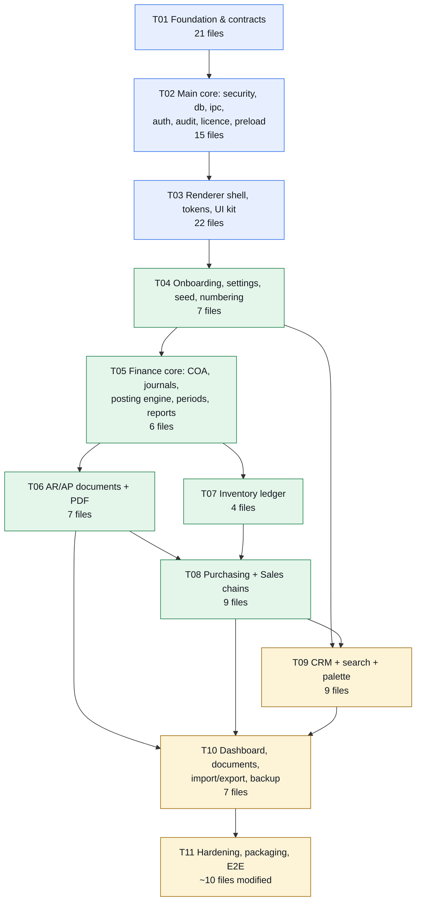

<!-- Copyright (c) 2026 arfanayub0. All rights reserved. Licensed under the NEXUS Proprietary Perpetual License. See LICENSE. -->

# NEXUS — Implementation Tasks

| Field | Value |
|---|---|
| **Version** | 1.0 |
| **Owner** | 高见远 (Architect) → executed by the Engineer |
| **Companion** | `ARCHITECTURE.md` (design), `CONVENTIONS.md` (per-file rules), `PRD.md` (acceptance source) |
| **Shape** | 11 tasks, dependency-ordered, each sized for one engineer and ≥3 files |
| **Rule** | A task is done only when `npm run typecheck` is clean, `npm run dev` boots, and its acceptance criteria are demonstrably true |

**Milestone map.** After **T02** the app boots to a login screen. After **T04** a fresh install completes onboarding and shows a navigable shell with real settings. After **T06** the accounting loop (invoice → journal → trial balance) is real. After **T08** all four operational modules work. After **T11** every one of the 72 routes exists and the app is packageable.

---

## T01 · Project foundation & shared contracts

**Goal.** A repository that installs, typechecks, builds and opens an Electron window showing a placeholder. All cross-process contracts (types, channel names, validators, money/date helpers, permissions, module + preset registries) exist and are frozen before any feature code is written.

**Files created**

```
package.json  tsconfig.json  tsconfig.main.json  vite.config.ts
tailwind.config.js  postcss.config.js  electron-builder.yml  .gitignore
LICENSE  EULA.md  README.md
scripts/gen-license-keys.mjs  scripts/keygen.mjs
src/shared/types.ts  src/shared/channels.ts  src/shared/schemas.ts
src/shared/money.ts  src/shared/dates.ts  src/shared/permissions.ts
src/shared/modules.ts  src/shared/industry-presets.ts
```

**Acceptance criteria**

1. `npm i` succeeds with **zero native module compilation**; `npm ls` shows no `better-sqlite3`, no `node-gyp`.
2. `npm run typecheck` exits 0 with `strict: true` and `noUncheckedIndexedAccess: true`.
3. `npm run build` produces `dist/renderer/index.html` and `dist/main/main/index.js` (CommonJS).
4. `npm run dev` opens a window with the placeholder; DevTools shows **zero network requests** beyond the Vite dev socket.
5. `money.ts` passes its inline assertions: `add(10,20)===30`, `0.1+0.2` never used, `roundHalfUp(1005,1)===101`, `roundHalfEven(5,0)===0`/`roundHalfEven(15,0)===20`, inclusive tax on 12000 @2000bp → net 10000 + tax 2000 === 12000 exactly.
6. `CHANNELS` is a `readonly` literal array of every channel in `ARCHITECTURE.md §C`; a unit test asserts no duplicates and that every channel appears in `PERMISSIONS` coverage map.
7. `INDUSTRY_PRESETS` has exactly 7 entries, each with `modules`, `coaSeed`, `taxes`, `numbering`, `customFields`, `landingModule`.
8. `scripts/gen-license-keys.mjs` writes `keys/private.pem` + `src/main/license/pubkey.ts`; `keys/` is gitignored, `pubkey.ts` is committed.

**Dependencies.** none

**Notes.** `sql.js` is a dependency but is not imported yet. `xlsx` is installed here so `dist` never surprises us. Pin Electron to **33.4.11** exactly.

---

## T02 · Main-process core: security, database, IPC, auth, audit, licence, preload

**Goal.** The privileged core works end to end: a hardened window, a `sql.js` database created and migrated on first run, the envelope dispatch pipeline, scrypt login, role resolution, hash-chained audit, and offline licence verification. The renderer can only call what preload allows.

**Files created**

```
src/main/index.ts  src/main/window.ts  src/main/security.ts  src/main/ipc.ts
src/main/db/connection.ts  src/main/db/schema.ts  src/main/db/migrate.ts
src/main/services/auth.ts  src/main/services/users.ts  src/main/services/audit.ts
src/main/services/license.ts
src/main/license/pubkey.ts  src/main/license/verify.ts  src/main/license/machine.ts
src/preload/index.ts
```

**Acceptance criteria**

1. `contextIsolation:true, sandbox:true, nodeIntegration:false, webviewTag:false`; `window.require` and `window.process` are `undefined` in the renderer console.
2. `window.nexus` exposes exactly `{invoke, on, platform, version}`; `nexus.invoke('bogus.channel')` rejects locally **and** returns `FORBIDDEN` if forced through `ipcRenderer`.
3. CSP header is present on the document response; an inline `<script>` injected via DevTools console is blocked.
4. `will-navigate` to `https://example.com` is prevented; `window.open` returns `null`; permission requests are denied.
5. First run creates `%APPDATA%/nexus/nexus.db`; second run opens it; `PRAGMA user_version` is 1.
6. `db.export()` → `nexus.db.tmp` → `renameSync` verified: killing the app mid-write never corrupts the existing file (test with a 200 ms debounce and a hard kill).
7. `auth.login` with a correct password returns `{user, permissions[]}`; wrong password 5× locks for `lockoutMin`; audit gains one `login_failed` row per attempt.
8. `audit.verify` returns `{ok:true}` on a clean log; manually editing one `after_json` in the file makes it return `{ok:false, brokenAtSeq:n}`.
9. `license.activate` with a key generated by `scripts/keygen.mjs` for **this** machine returns `edition:'pro'`; the same key with a different `machine_id` returns `CONFLICT`; a key with a flipped signature byte returns `VALIDATION`.
10. Setting the OS clock back 1 day then relaunching sets `suspect_clock=1`, shows a warning flag in `app.bootstrap`, and **all channels still succeed**.
11. No SQL error string or stack trace ever reaches the renderer: forcing a constraint violation returns `{ok:false, error:{code:'CONFLICT', message:'<human text>'}}`.

**Dependencies.** T01

**Notes.** `locateFile` must resolve both paths — dev: `node_modules/sql.js/dist/sql-wasm.wasm`; packaged: `process.resourcesPath/sql-wasm.wasm`. Document the resolution in a comment and cover it in T11.

---

## T03 · Renderer shell, design tokens and UI kit

**Goal.** A navigable, themed, keyboard-first shell with the reusable primitives every later task builds on: tokens, layout, table, overlays, fields, chart wrappers, and the IPC data layer with cache and invalidation.

**Files created**

```
src/renderer/index.html  src/renderer/main.tsx  src/renderer/App.tsx  src/renderer/index.css
src/renderer/lib/api.ts  src/renderer/lib/format.ts  src/renderer/lib/useQuery.ts  src/renderer/lib/toast.ts
src/renderer/store/index.ts
src/renderer/components/AppShell.tsx  Sidebar.tsx  Topbar.tsx  DataTable.tsx
src/renderer/components/Modal.tsx  Drawer.tsx  Field.tsx  DocumentBuilder.tsx
src/renderer/components/Chart.tsx  LockScreen.tsx  PermissionGate.tsx  ui.tsx
src/renderer/components/Toast.tsx
```

**Acceptance criteria**

1. Every token in `ARCHITECTURE.md §E.3` exists as a CSS variable in `:root` and `[data-theme="dark"]`; `grep -rn "#[0-9a-fA-F]\{6\}" src/renderer/components src/renderer/pages` returns **zero hits** (tokens file excepted).
2. Light/dark toggle and density toggle switch instantly with no reload and persist across restart via `app.prefs.save`.
3. `DataTable` renders 10 000 mock rows: DOM contains ≤45 `<tr>` at any scroll position; scrolling holds ≥50 fps in the Performance panel; header stays sticky.
4. `DataTable` keyboard: `↓` moves focus, `Space` opens the peek `Drawer`, `Esc` restores focus to the originating row, `x` toggles selection.
5. `Modal` and `Drawer` trap focus, restore it on close, and close on `Esc`; `aria-modal`, `aria-labelledby` present.
6. `Drawer` does **not** unmount the underlying route (verified by typing in a form, opening a peek, closing it, text still there).
7. `Field` renders label, `*` for required, error below input wired with `aria-describedby`; validation fires on blur only.
8. `useQuery` dedupes two simultaneous calls to the same key into one IPC call (count in the main log); `invalidate(['invoices'])` refetches dependent keys only.
9. `api.invoke` turns `{ok:false}` into a typed `ApiError` with `.code`; unhandled errors surface as a sticky toast, never a white screen.
10. Skip-to-content link is the first tab stop; `main`/`nav`/`aside` landmarks exist; a 2px focus ring is visible on every control.
11. `Sidebar` collapses 240px ↔ 64px, groups by module manifest, hides modules without permission, and is driven by `MODULES` + session permissions only.

**Dependencies.** T02

**Notes.** No component library. `clsx` is the only styling helper. `recharts` is imported lazily so it never enters the shell chunk.

---

## T04 · Onboarding, settings, seeding and numbering

**Goal.** A fresh install completes the 5-step wizard in one transaction, applies an industry preset, seeds demo data, and manages company/users/roles/custom fields/taxes/currencies/numbering. This is the task that makes the product demonstrable.

**Files created**

```
src/main/services/settings.ts  src/main/db/seed.ts  src/main/jobs.ts
src/renderer/pages/Onboarding.tsx
src/renderer/pages/settings/Company.tsx  People.tsx  Data.tsx  System.tsx
```

**Acceptance criteria**

1. Fresh launch with no DB lands on `/onboarding`; **no other route is reachable** (`/dashboard` redirects back) — US-01.
2. Step 2 shows a preset preview (modules, COA count + sample, taxes, numbering, custom fields) and applies **nothing** until confirm — US-02.
3. `onboarding.complete` runs migrations → preset → CoA seed → sequences → pipelines → admin user → optional demo data in **one transaction**; a forced failure at the demo step leaves no partial company (verify: `SELECT count(*) FROM accounts` = 0).
4. With demo data: ≥3 customers, ≥3 vendors, ≥8 products, ≥6 invoices, ≥5 deals, ≥1 warehouse + 2 locations, stock moves; dashboard KPIs non-zero — US-03.
5. Skipping the licence step lands on Community with a dismissible notice that stays dismissed across restarts — US-04, BR-25.
6. Numbering: prefix `INV-`, padding 5, post 3 invoices → `INV-00001..00003`; deleting a draft does not consume a number — BR-08, US-50.
7. Custom field `customers.GSTIN` (text, required) appears on the customer form, blocks save when empty, and is exportable — US-49.
8. Role editor toggles a permission and the affected user's sidebar/buttons change on next login; the main process rejects the call even if the button is forced — US-07, BR-20.
9. Deleting a user with audit rows is refused with an offered "Disable" — US-08, BR-22.
10. Base currency change is refused once any `journal_entries` row is posted — BR-23.
11. `settings.demoData.remove` deletes only seeded rows (tagged `is_demo=1` via `meta_json`) and leaves user-created rows intact.

**Dependencies.** T03

---

## T05 · Finance core: chart of accounts, journals, posting engine, periods, reports

**Goal.** The double-entry engine. This is the task the whole product's credibility rests on: balanced-or-reject, immutable posted entries, reversal, period locks, and four reports that drill.

**Files created** (6 — 1 of them an extension of an existing service)

```
src/main/services/finance.ts          (COA, journals, posting engine, periods, reports)
src/main/services/settings.ts         (extend: numbering.next / preview / reset)
src/renderer/pages/finance/Accounts.tsx  Journals.tsx  Reports.tsx  Periods.tsx
```

**Acceptance criteria**

1. COA tree renders with expand/collapse; a parent balance equals the sum of its children; an account with postings cannot be archived — US-16.
2. Posting 1000 debit / 900 credit is refused with `Out of balance by 100.00`; **no row is written** (count unchanged) — US-17, BR-01.
3. A posted entry is read-only in the UI; only Reverse and Print are offered; reversing twice yields two distinct entries each with `reverses_id`; the original is byte-identical — US-18, BR-02/03.
4. Trial balance shows `Σ debits == Σ credits` as an explicit check; every row drills to GL; GL rows drill to the journal — US-21.
5. P&L groups by account type with a comparative column; balance sheet satisfies `Assets == Liabilities + Equity` at any date — US-22.
6. Posting into a locked period is refused naming the lock date and locking user; unlocking requires a reason and writes an audit row — US-23, BR-04.
7. Posting is atomic: forcing an error after the journal insert leaves no `journal_entries` row.
8. Every posting writes exactly one `audit_log` row with `before`/`after`; `audit.verify` stays `ok:true` after 100 postings.
9. Reports aggregate in SQL; the GL for an account with 5 000 lines renders in ≤300 ms.
10. `assertPeriodOpen` and the balance assertion are the only two gates — no posting path bypasses them (verified by a test that calls each posting function with an unbalanced fixture).

**Dependencies.** T04

**Notes.** Build the posting engine as one private function `writeJournal(tx, {date, journalCode, lines, sourceType, sourceId})` used by invoices, bills, payments, receipts, deliveries and adjustments. Never duplicate the balance check.

---

## T06 · AR/AP documents: invoices, bills, payments, allocation

**Goal.** The documents Marcus lives in: invoice and bill builders with tax/discount math in minor units, automatic balanced journals on post, payments with allocation, and the split-view builder with live preview.

**Files created**

```
src/main/services/finance.ts            (extend: invoices, bills, payments, allocation)
src/main/services/documents.ts          (pdf preview/save/print/export dispatch — stub renderer)
src/main/pdf/template.ts  src/main/pdf/render.ts
src/renderer/pages/finance/Invoices.tsx  Bills.tsx  Payments.tsx
```

**Acceptance criteria**

1. Invoice with 2 lines, 10% tax, 5% line discount computes in cents; the posted journal is balanced and shows `Dr 1100 / Cr revenue / Cr 2200` with the exact amounts — US-19.
2. Tax-inclusive document: gross 120.00 @20% → net 100.00 + tax 20.00 and `net + tax === gross` exactly — BR-07, US-51.
3. Three lines of 33.335 at 2 dp → document total 100.01 (half-up at document level only) — BR-06.
4. Payment of 400.00 against a 1,000.00 invoice → `partially_paid`, open 600.00; a second 600.00 → `paid`; allocating 1,200.00 is refused — US-20, BR-19.
5. Posting assigns a gapless number atomically; a posted number is never reused or renumbered — BR-08/09.
6. Posted invoices are immutable in the UI; Void creates a reversing entry linked to the original.
7. `documents.pdf.preview` returns HTML for the shared A4 template with company header, customer block, line table, tax summary, totals; all five doc types use the same template with a different title/columns — US-45/46.
8. `documents.pdf.save` writes a real PDF to a user-chosen path and the file opens in the OS viewer with correct page count.
9. Split-view builder re-renders the preview with a 250 ms debounce; typing does not block; `⌘S` saves, `⌘Enter` posts.
10. `entity.export` produces XLSX/CSV matching the filtered, sorted, visible columns with money as numbers and dates as ISO — US-47.

**Dependencies.** T05

---

## T07 · Inventory: products, warehouses, moves, on-hand, valuation

**Goal.** The append-only stock ledger. On-hand is derived, never typed; four move types; negative stock blocked unless permitted; valuation reproducible from moves.

**Files created**

```
src/main/services/inventory.ts
src/renderer/pages/inventory/Products.tsx  Warehouses.tsx  Stock.tsx
```

**Acceptance criteria**

1. Duplicate SKU is refused naming the conflicting product; duplicate barcode refused — US-24.
2. There is **no IPC channel and no UI control** that sets a quantity: `grep -n "qty_milli" src/main/services/inventory.ts` shows only move-derived writes — US-26, BR-10.
3. Transfer of 30 from a 100-unit total keeps total on-hand at 100 and moves per-location balances; the move row records type/from/to/qty/user/time — US-25, BR-12.
4. Issuing 15 with 10 on hand is refused showing available; with `inventory.stock.allow_negative` and a reason it succeeds and writes an audit row — US-27, BR-11.
5. Adjustment of −3 with a reason sets on-hand to 47 and writes a variance row.
6. `inventory.valuation` recomputes from moves per the product's cost method and is identical before/after `inventory.quants.rebuild` (proves the cache is derived).
7. Reorder point 20 with 12 on hand flags the product Low and it appears in the low-stock channel used by the dashboard — US-28.
8. Posting a receipt/issue writes the correct inventory journal (Dr 1200 / Cr 2100 or Dr 5000 / Cr 1200) — `ARCHITECTURE.md §B.4`.
9. Product detail "Moves" tab shows a running balance that ends at the current on-hand.

**Dependencies.** T05

---

## T08 · Purchasing and Sales document chains

**Goal.** The two document chains that make it an ERP: PO → partial receipt → bill → 3-way match, and quote → order → delivery → invoice → payment, plus price-list resolution.

**Files created**

```
src/main/services/purchasing.ts  src/main/services/sales.ts
src/renderer/pages/purchasing/Vendors.tsx  Orders.tsx  Receipts.tsx
src/renderer/pages/sales/Customers.tsx  Quotations.tsx  Orders.tsx  PriceLists.tsx
```

**Acceptance criteria**

1. PO for 100: receive 40 → status `partially_received`, 40 received / 60 outstanding; receive 60 → `received` — US-29.
2. "Create bill" from a posted receipt pre-fills received qty and PO prices and links `po_id` + `receipt_ids` — US-30.
3. 3-way match: billed qty > received → exception; price +1.9% with 2%/50.00 caps → passes; +2.5% → exception requiring `purchasing.bill.approve_exception` **and** a non-empty reason, audited — US-31, BR-13/14.
4. Vendor with Net 30: bill due date defaults to date + 30 and is editable; vendor with bills cannot be deleted — US-32.
5. Expired quote cannot convert without `sales.quotation.override_expiry`; the override is audited — US-33, BR-18.
6. Quote → order carries lines, prices, discounts, taxes and cross-links both ways; quote becomes `converted` — US-34.
7. Order for 10, delivered 4 → line reads ordered 10 / delivered 4 / to deliver 6, header `partially_delivered` — US-35.
8. Price resolution: contract → customer list → default list → base, first non-expired match; an expired customer list falls through; manual override is labelled — US-36, BR-17.
9. Customer with 30-day terms: invoice due date = date + 30; customer record shows total outstanding — US-37.
10. Delivery posts stock issues and a COGS journal; invoice from order pre-fills delivered quantities — PRD §6.2.
11. Every document shows a status chip rail with only the legal next actions for its state.

**Dependencies.** T06, T07

---

## T09 · CRM: accounts, contacts, leads, atomic conversion, deals kanban, activities, analytics

**Goal.** The differentiator module. Atomic lead conversion, a keyboard-operable kanban with optimistic stage moves and stage totals, an activity timeline as the record spine, and derived analytics.

**Files created**

```
src/main/services/crm.ts  src/main/services/search.ts
src/renderer/pages/crm/Accounts.tsx  Leads.tsx  Deals.tsx  Activities.tsx  Analytics.tsx
src/renderer/components/Kanban.tsx  src/renderer/components/CommandPalette.tsx
```

**Acceptance criteria**

1. A contact belongs to exactly one account and appears in that account's contacts tab and timeline — US-38.
2. Lead conversion creates account + contact + deal in **one transaction**: forcing a failure at the deal insert leaves zero new accounts/contacts and the lead unchanged — US-39, BR-15.
3. Kanban drag to another stage persists optimistically, updates column count/Σ value/Σ weighted immediately, and logs a `stage_changed` activity; a failed IPC rolls the card back with a sticky error toast — US-40.
4. Kanban is fully operable by keyboard: `←/→` between columns, `↑/↓` between cards, `Shift+←/→` moves a card, change announced via `aria-live` — PRD §9.
5. Adding a stage "Pilot" at 65% makes it a column and contributes `value × 0.65` to the weighted forecast — US-41.
6. Timeline shows call/email/meeting/task with icons, author, timestamp; overdue tasks are visually distinct — US-42.
7. Closing as Lost without a reason is refused; reasons come from the configurable list — US-43, BR-16.
8. Analytics shows win rate, average cycle length, forecast vs closed and a per-owner leaderboard for the selected period — US-44.
9. `Ctrl/Cmd+K` works inside an input, groups results (Records / Actions / Navigation), max 8 per group, is keyboard-navigable, and `Enter` navigates without a full reload — US-54.
10. Global search for "acme" returns matching accounts, contacts, deals, invoices and orders with type badges — US-58.

**Dependencies.** T04 (settings/custom fields), T08 (orders for `deal → order`)

---

## T10 · Dashboard, documents, import/export, backup, audit viewer

**Goal.** The "is my business OK" surface, the five printed documents, the import wizard, and the data-safety features a business will not run without.

**Files created**

```
src/main/services/dashboard.ts  src/main/services/importexport.ts  src/main/services/backup.ts
src/renderer/pages/Dashboard.tsx  Search.tsx  Print.tsx
src/renderer/pages/settings/Data.tsx            (extend: import wizard route)
src/renderer/pages/settings/System.tsx          (extend: backup, audit viewer, licence, security, appearance)
```

**Acceptance criteria**

1. Six KPI cards (Revenue, Expenses, Net profit, Open AR, Weighted pipeline, Low stock) each show a value and a % delta vs the prior equal-length period — US-13.
2. Revenue/expense chart covers 12 months; pipeline summary lists stages with count, Σ value and Σ (value × probability); clicking a stage opens the filtered kanban — US-15.
3. Needs-attention lists a 15-day-overdue invoice and a below-reorder product, each one-click to the record, with a proper empty state — US-14.
4. Import wizard: a 200-row CSV with 3 bad rows stages 197, lists 3 with row number and reason, and commits only the valid rows — US-48.
5. Backup writes a consistent copy, `PRAGMA integrity_check` passes, the file is sha256-stamped; restore validates, warns, replaces data and forces re-login — US-52.
6. Audit viewer filters by user/entity/action/date, shows before/after, and has **no** edit or clear affordance; `audit.verify` is exposed as a button — US-53, BR-21.
7. All five document types print from the shared template; `⌘P` prints; Save-as-PDF writes a file — US-46.
8. `settings.demoData.remove` reachable from the UI.
9. Licence page shows edition, licensee, machine ID (copyable), `expiresAt: null`, and a working Deactivate that returns to Community and audits — US-10/11.
10. Appearance page: theme, density, accent; choices persist per user — US-57.
11. `?` opens the shortcut cheat sheet; `g d`, `n`, `Esc`, `/` work as documented — US-56.

**Dependencies.** T06, T08, T09

---

## T11 · Hardening, packaging and end-to-end verification

**Goal.** Ship it. Packaged Windows build that finds its wasm, prints correctly, passes the 25 business rules, and has no CSP or navigation holes.

**Files modified**

```
electron-builder.yml  package.json (build scripts)  README.md
src/main/window.ts  src/main/security.ts  src/main/db/connection.ts  (path resolution)
src/renderer/index.css  (a11y + reduced-motion pass)
src/renderer/pages/*  (empty/error/loading states audit)
```

**Acceptance criteria**

1. `npm run dist` produces an NSIS installer **and** a portable exe; both launch on a machine with no Node installed.
2. **Packaged** app loads `sql-wasm.wasm` from `resources/`; verified by launching the installer build and completing onboarding. A deliberate rename of the wasm file produces a readable error dialog, not a white screen.
3. Packaged app: DevTools disabled, app menu removed, single-instance lock works (second launch focuses the first), no remote request in any session log.
4. `printToPDF` works in the packaged build for all five document types; A4, correct margins, page numbers, no clipped tables.
5. A scripted walkthrough of **BR-01 … BR-25** passes; results recorded in `docs/QA-RULES.md`.
6. Cold start to interactive dashboard ≤3.0 s on a 100k-document DB; route change ≤300 ms; 10k-row table ≥50 fps.
7. `npm run typecheck` clean; renderer bundle ≤1.5 MB gzip (`dist/renderer/assets/*.js` summed).
8. `grep -rn "if (industry" src/` returns nothing (R7 guard) and `grep -rn "#[0-9a-f]\{6\}" src/renderer/components` returns nothing.
9. Every one of the 72 routes in `ARCHITECTURE.md §E.1` resolves without a console error, including a permission-denied case and a module-disabled case.
10. `LICENSE`, `EULA.md`, and the copyright header are present in every `.ts/.tsx/.css` file (scripted check).

**Dependencies.** T10

---

## Dependency graph



**Parallelisable windows.** T06 and T07 can run concurrently after T05. T09 can start after T04 (its CRM half) with the deal→order link deferred until T08 lands.

**Critical path.** T01 → T02 → T03 → T04 → T05 → T06 → T08 → T10 → T11.

---

## The six highest-risk items

| # | Risk | Why it bites | Mitigation (owner task) | Detection |
|---|---|---|---|---|
| **R1** | **`sql.js` wasm path in the packaged build** | `locateFile` is resolved at runtime; in dev the file is in `node_modules`, in production it must be in `resources/`. A wrong path is a white screen on the user's machine and works perfectly on ours | T02 resolves both branches with `app.isPackaged`; `electron-builder.yml` copies `node_modules/sql.js/dist/sql-wasm.wasm` → `extraResources` as `sql-wasm.wasm`; T11 test #2 renames the file to prove the error path; boot wraps `initSqlJs` in a `dialog.showErrorBox` with the resolved path | Install the NSIS build on a clean VM in T11, not just `npm run dev` |
| **R2** | **`printToPDF` from a sandboxed/hidden window** | A hidden `BrowserWindow` with `sandbox:true` and `javascript:false` may not finish layout before `printToPDF`; `data:` URLs can be blocked by our own CSP; fonts may not load in time | T06 uses `loadURL('data:text/html;base64,…')` with `await win.webContents.executeJavaScript('document.fonts.ready')` guarded by a `did-finish-load` + 50 ms settle; template uses **system font stack only** (no webfont) so there is nothing to wait for; window is `show:false` and reused across calls; `printBackground:true`, `pageSize:'A4'` | Snapshot test: render one fixture of each of the 5 doc types and assert page count + no clipped table in T11 |
| **R3** | **Kanban drag-and-drop accessibility + optimistic rollback** | HTML5 DnD is mouse-only and fires erratically in Chromium; optimistic moves that fail leave the board lying to the user | T09 ships `Kanban` with `draggable` + explicit `dragstart/dragover/drop` on column drop-zones, **plus** a keyboard path (`Shift+←/→` and a per-card "Move to…" menu). Optimistic update stores a snapshot; a rejected IPC restores it and raises a sticky toast with the reason. Stage change is a single `crm.deal.moveStage` call, never a batch | T09 acceptance #3/#4; a11y check with keyboard only, no mouse |
| **R4** | **Large-table virtualisation by hand** | 10 000 rows in the DOM kills the frame budget; a naive windowing implementation mis-measures with a sticky header, variable density and `total` paging | T03 `DataTable` uses **fixed** row height from `--row-h` (40/52), `translateY` offsets, spacer divs, `overscan=6`, and re-measures only on density change. Column widths are explicit, never `auto`. `onEndReached` fires at 80% scroll for paging | T03 acceptance #3: measure with 10k mock rows in the Performance panel before any real page consumes it |
| **R5** | **Rounding on tax and discounts** | Half-up per line and half-up per document disagree by a cent; inclusive tax computed as `gross × r` breaks `net + tax === gross`; a float creeps in via `qty × price / 100` | All arithmetic is integer cents in `money.ts`; quantities are milli-units; per-line tax uses `roundHalfEven`, document total uses `roundHalfUp` (BR-06); inclusive tax is **back-computed** so `net + tax === gross` by construction (BR-07); a unit test table covers 33.335×3, 120.00 @20% incl, 5% line discount + 10% tax, 0.1+0.2 | T05/T06 acceptance #2/#3 + the `money.ts` assertion block in T01 |
| **R6** | **Licence key parsing** | `NEXUS-<EDITION>-<b32url(payload)>-<b32url(sig)>` must be split without ambiguity (the payload is JSON containing `-`), base32url has no Node decoder, and a 64-byte Ed25519 signature is 103 base32 chars | T02 parses with an anchored regex `^NEXUS-(COMMUNITY\|PRO\|ENTERPRISE)-([A-Z2-7]+)-([A-Z2-7]+)$` and validates by **length + decodability**, not by splitting on `-`; base32url decode is ~15 lines of bit-shifting in `verify.ts` (no dependency); `crypto.verify` is wrapped in try/catch so a malformed key returns `VALIDATION`, never `INTERNAL`; the payload's `machine_id` comparison happens **after** signature verification | T02 acceptance #9 uses a real key from `keygen.mjs` and three negative fixtures (flipped byte, wrong machine, truncated) |

---

## Definition of done (every task)

| Gate | Check |
|---|---|
| Types | `npm run typecheck` exits 0 |
| Boot | `npm run dev` reaches the task's surface with no console error |
| Contracts | Any new channel is added to `channels.ts` + `preload` allow-list + `ipc.ts` permission map in the same commit (see `CONVENTIONS.md §7`) |
| Header | Copyright header on every new `.ts/.tsx/.css` file |
| Tokens | No hex literal in any component; no `style={{color:'…'}}` |
| Money | No `*` or `/` on a `_cents` value outside `money.ts` |
| Audit | Every mutation writes exactly one audit row |
| A11y | Keyboard path exists for every mouse path; focus visible; `Esc` closes overlays |
